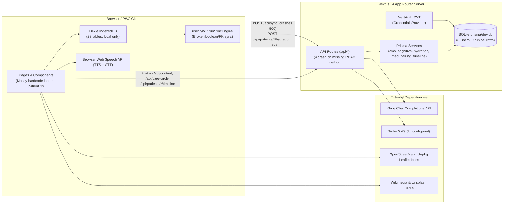

# SMRITI (Smriti-NER) — Comprehensive Product, Engineering & UX Audit

**Audit Date:** 2026-11-25  
**Audited Codebase:** `C:\E_Drive\final ka final build` (Canonical active build; contextual comparison against sibling directories in `C:\E_Drive`)  
**Audit Scope:** Analysis-only multidisciplinary review (Architecture, Frontend, Backend, Database, UI/UX, Accessibility, QA, AI/ML, Security, DevOps, Healthcare Product Management). No source code, packages, environment files, or database records were modified.

---

## 1. Executive Summary

Smriti (`ner-cognitive-app` / branded interchangeably as **Smriti** and **Daily Rhythm**) aims to serve elderly patients experiencing mild dementia or cognitive decline in India's North Eastern Region (NER), alongside their family caregivers and clinicians. The codebase shows ambitious product breadth—covering 14 cognitive mini-games, daily routine planning, medication/hydration tracking, geofenced safety zones, 16 NER language options, a voice companion, and caregiver/clinician portals—but **is not currently deployable or functional as a cohesive multi-user healthcare product**.

### Overall Readiness Verdict

| Dimension | Verdict | Key Finding |
| :--- | :--- | :--- |
| **Product Cohesion** | **Incomplete / Disconnected** | Core features are split between local browser IndexedDB (`demo-patient-1`) and an unaligned Prisma/SQLite backend (`dev.db`). Most patient actions never reach the server. |
| **Backend & API Reliability** | **Broken (Critical)** | 4 core API routes crash with HTTP `500` because they call `RBAC.requirePatientAccess()`, which does not exist in `src/lib/rbac.ts`; `/api/sync` references a nonexistent `prisma.patientSyncData` model; `CMSService.seedInitialContent()` uses `createMany` which Prisma 5.11.0 does not support on SQLite. |
| **Code & Build Quality** | **Failing Gates** | `next.config.mjs` suppresses **59 TypeScript errors** (`ignoreBuildErrors: true`) and **146 ESLint errors / 15 warnings** (`ignoreDuringBuilds: true`). |
| **Security & Privacy** | **High Risk** | Hardcoded fallback `NEXTAUTH_SECRET` and client-exposed `NEXT_PUBLIC_ENCRYPTION_KEY`; demo RBAC bypasses in `/caregiver` and `/doctor`; zero auth guards on all 8 `/caregiver/*` subpages; unauthenticated `/api/predict`, `/api/alert`, `/api/sync`, `/api/chat`; unrestricted clinician read access (`RBAC.verifyPatientAccess`); false UI claims of HIPAA compliance and server encryption. |
| **AI & Regional Intelligence** | **Stubbed / Divergent** | Uses Groq (`openai/gpt-oss-20b`) with broken auth fallback to `'demo-patient-1'`. `@google/generative-ai` + `GEMINI_API_KEY` are unused; Bhashini, Vosk, and TFLite do not exist in the codebase; `/api/predict` is a hardcoded 40-line `if/else` heuristic. |
| **Accessibility (65–85 yrs)** | **Needs Major Work** | `10px–11px` labels, squished bottom-nav icon, hover-only settings menu on `/`, `alert()`/`confirm()` dialogs, floating buttons overlapping inputs on mobile, and 13+ selectable languages lacking TTS voices and full UI translations. |

### Workspace Context (`C:\E_Drive`)
Inspection of `C:\E_Drive` identified four project directories and five zip archives:
1. `C:\E_Drive\final ka final build` — **Latest active directory** (127 source/config files excluding `node_modules` and `.next`; includes `src/app/profile/page.tsx`, updated `src/app/page.tsx`, `prisma/dev.db`, and `.next` cache from `25-11-2026 15:25`).
2. `C:\E_Drive\final ka final build - Copy` — Earlier snapshot missing `src/app/profile/page.tsx` and differing on `src/app/page.tsx` and `prisma/dev.db`.
3. `C:\E_Drive\ner-cognitive-app` & `ner-cognitive-app-copy` — Earlier static-export + Capacitor Android prototype (`capacitor.config.ts`, `android/`, `out/`, and removed dashboard components `CalendarModal.tsx`, `OrientationModal.tsx`, `TaskCard.tsx`, `TaskCelebrationModal.tsx`). Note that Android/Capacitor packaging was dropped in `final ka final build` in favor of NextAuth + Prisma + `next-pwa`.

---

## 2. Existing Technology Stack

### Verified Installed & Active Dependencies (`package.json`)
- **Framework:** Next.js `14.2.35` (App Router), React `^18`, TypeScript `^5`
- **Styling & Animation:** Tailwind CSS `^3.4.1`, PostCSS `^8`, Framer Motion `^13.2.0`, Lucide React `^1.40.0`
- **Authentication:** NextAuth.js `^4.24.15` (`CredentialsProvider` + JWT session strategy), `bcryptjs` `^3.0.3`
- **Database & Client Persistence:** Prisma `^5.11.0` / `@prisma/client` `^5.11.0` with **SQLite** (`prisma/dev.db`), Dexie `^4.4.5` + `dexie-react-hooks` `^4.4.0` (IndexedDB)
- **Data Visualization & Mapping:** Recharts `^3.10.1`, Leaflet `^1.9.4`, React-Leaflet `^4.2.1`
- **PWA:** `next-pwa` `^5.6.0` (disabled in `development` via `next.config.mjs`)
- **AI & Messaging SDKs:**
  - Groq REST API (`https://api.groq.com/openai/v1/chat/completions`) called directly via `fetch()` in `src/app/api/chat/route.ts`
  - `@google/generative-ai` `^0.24.1` — **installed in `package.json`, NOT imported anywhere in `src/`**
  - `twilio` `^6.1.1` — imported in `src/app/api/alert/route.ts` (falls back to `console.log` when env vars missing)
  - `crypto-js` `^4.2.0` — client-side AES helper in `src/lib/security.ts`
  - `swiper` `^14.2.0` — **installed in `package.json`, NOT imported anywhere in `src/`**

### Planned Vision Stack vs. Reality

| Planned Technology | Status in Codebase |
| :--- | :--- |
| **Gemini (`@google/generative-ai`)** | Installed in `package.json` and `GEMINI_API_KEY` set in `.env.local`, **0 imports/usages in `src/`**. Replaced by Groq API (`openai/gpt-oss-20b`). |
| **RAG Pipeline** | **Partial / Broken pseudo-RAG.** `src/app/api/chat/route.ts` queries Prisma `TimelineService` and `HydrationEvent` directly (no embeddings/vector search), and auth failure forces `patientId = 'demo-patient-1'`. |
| **Bhashini API** | **Absent.** Zero references in codebase. Uses static dictionary (`src/lib/translations.ts`) + browser `window.speechSynthesis`. |
| **Vosk (Offline STT)** | **Absent.** Zero references. Uses browser `SpeechRecognition` / `webkitSpeechRecognition` only. |
| **TensorFlow Lite (On-device ML)** | **Absent.** Zero references. `/api/predict` and `src/lib/ai-difficulty.ts` are deterministic heuristics. |

---

## 3. Current Architecture Overview

The application attempts a hybrid **offline-first PWA + centralized SQLite API** architecture, but the two halves are disconnected ("split-brain" state):

### Key Architectural Observations
1. **Global Shell Coupling (`src/app/layout.tsx`):** Wraps every route—including `/login`, `/register`, `/caregiver/*`, `/doctor`, and all games—in `ClientProviders` (`AuthProvider`, `I18nProvider`, `VoiceAssistantProvider`, `SyncManager`, global floating `SpeakButton`) and global `<BottomNav />`.
2. **Broken Sync Bridge:** `ClientProviders` runs `useSync()` on mount/online, posting `db.tasks`, `db.gameLogs`, `db.moods` to `/api/sync` (which crashes because `prisma.patientSyncData` does not exist) and querying `.where('synced').equals(0)` against boolean `false` values. Meanwhile, `runSyncEngine()` in `src/lib/db.ts` is only triggered manually from `/caregiver` and only attempts to push `hydrationEvents` and `medicationEvents` (sending `medicationName` as `medicationId`). All other 18+ Dexie tables (`wellbeingEntries`, `dailyRoutines`, `routineOccurrences`, `vitalLogs`, `caregiverReports`, `prescriptions`, `safeZones`, `locationEvents`, `voiceReminders`, `familyAssets`, `careCircleMembers`, `careUpdates`, `localResources`, `savedResources`, `scrapbook`) have **zero backend sync**.
3. **Database State Proof:** Inspection of `prisma/dev.db` shows **3 `User` / `PatientProfile` rows** and **0 rows** in every other table (`CaregiverProfile`, `ClinicianProfile`, `PatientCaregiver`, `CareCircleMember`, `PairingInvitation`, `Medication`, `MedicationEvent`, `HydrationTarget`, `HydrationEvent`, `VitalLog`, `SleepRecord`, `ActivityRecord`, `MoodRecord`, `CognitiveSession`, `HealthScore`, `ContentItem`, `CaregiverReport`, `AuditLog`).

---

## 4. Complete Feature Inventory

| Component / Route | Purpose | Implementation Location | Working Status | Dependencies | What Is Missing |
| :--- | :--- | :--- | :--- | :--- | :--- |
| **Auth Login & Register** | Email/password sign-in and role registration | `src/app/login/page.tsx`, `src/app/register/page.tsx`, `src/lib/auth.ts`, `src/app/api/auth/*` | **Works** (with security flaws) | NextAuth, Prisma, `bcryptjs` | Password policy, role verification, rate limiting, `NEXTAUTH_SECRET` in env, email verification |
| **Patient Home ("My Day")** | Greeting, SOS, AI bar, location consent, check-in CTA, Now/Today planner, Help Near Me | `src/app/page.tsx`, `src/components/patient/*`, `src/hooks/useDailyPlanner.ts` | **Partial / Broken on cold load** | NextAuth, Dexie, `/api/content`, `/api/alert` | Real `session.user.profileId` (hardcodes `'demo-patient-1'`), working `/api/content`, hydration UI, dynamic greeting by time of day, link to `/games` |
| **Patient Profile** | Display user info & sign out | `src/app/profile/page.tsx` | **Partial** | NextAuth | Profile editing, pairing code redemption, emergency contact/blood group editing, truthful security/sync labels |
| **Daily Check-In** | 6-step mood, sleep, confusion, energy, pain, overall check-in | `src/app/check-in/page.tsx` | **Local-only** | Dexie `wellbeingEntries`, Web Speech | Backend API persistence, full i18n, locale-aware TTS, auth guard |
| **Help Near Me** | Categorized verified local NER care resources | `src/app/help-near-me/page.tsx` | **Partial** | Dexie `localResources` | Backend resource catalog, Emergency/Elder Care seeded entries, StrictMode-safe seeding, geolocation distance sorting |
| **Memory Scrapbook** | Photo & audio reminiscence cards | `src/app/scrapbook/page.tsx` | **Mock / Placeholder** | Hardcoded 4-item array, Unsplash | Connection to `db.scrapbook` / `db.familyAssets` / backend, real audio recording (`handleRecord` is a `setTimeout` stub), music audio file |
| **Cognitive Games Hub & 14 Games** | Cognitive stimulation & personalized family recall | `src/app/games/page.tsx` + 14 `src/app/games/*/page.tsx` | **Mixed (5 log locally, 1 crashes API, 7 toy-only, 2 orphaned)** | Dexie `gameLogs`/`familyAssets`, `NER_ASSAM_PACK`, `/api/patients/*/cognitive` | Unified session logging to backend, fixing `color-sequence` level bug, adding `pattern-weave`/`word-garden` to hub, offline local images |
| **AI Voice Companion** | Voice/text conversational Q&A for patient | `src/components/voice/ConversationalUI.tsx`, `src/app/api/chat/route.ts` | **Partial (uses demo fallback context)** | Groq API, Web Speech STT/TTS, `TimelineService` | Working RBAC session resolution, Bhashini/Vosk regional STT/TTS, translated UI copy |
| **Caregiver Dashboard** | Patient today stats, sync, wearables, care circle, subpage links, 30-day vitals, scrapbook upload, cognitive chart | `src/app/caregiver/page.tsx` | **Partial / Security bypass** | Dexie, `/api/caregiver/patients`, `/api/care-circle`, `Security.encrypt` | Role enforcement (bypass commented out), real multi-patient selection, working `/api/care-circle`, real wearable sync, syncing vitals/reports/scrapbook |
| **Caregiver Subpages (8 routes)** | Routines, Voice, Family Assets, Safety Map, Wellbeing, Care Circle, Resources, Settings | `src/app/caregiver/{routines,voice,family,safety,wellbeing,circle,resources,settings}/page.tsx` | **Mixed (Settings & Circle Invite/Edit & Wellbeing Report are stubs)** | Dexie, Leaflet/OSM, `MediaRecorder` | Auth guards on all 8 routes, real backend persistence, working Settings page, Care Circle invite flow, PDF/CSV report download |
| **Doctor / Clinical Portal** | Patient snapshot, vitals, Rx management, longitudinal timeline, XAI risk/BPSD/Sundowning | `src/app/doctor/page.tsx`, `src/app/api/predict/route.ts`, `src/app/api/patients/*/timeline` | **Mocked / Broken APIs / Security bypass** | Dexie `prescriptions`, `/api/predict`, `/api/patients/*/timeline` | Role enforcement, real patient selector, working timeline API, real vitals/BPSD/sundowning data, backend Rx persistence, report export |
| **Caregiver-Patient Pairing** | 6-digit invite codes and authorization link | `src/services/pairing.service.ts` | **Orphaned Service** | Prisma `PairingInvitation`, `PatientCaregiver` | API routes and UI screens to generate and redeem 6-digit pairing codes |

---

## 5. Implemented Versus Incomplete Functionality

### Fully Implemented (End-to-End Within Current Design)
- User credential registration & login (`POST /api/auth/register`, NextAuth `CredentialsProvider` against SQLite `User` + role profile creation).
- Caregiver routine & voice reminder creation in local IndexedDB (`/caregiver/routines`, `/caregiver/voice`) feeding `useDailyPlanner` -> `NowCard` / `PlannerTimeline` on the same browser device.
- Caregiver family asset creation (`/caregiver/family`) feeding `/games/guess-faces` and `/games/recognize-voices` locally via Dexie.
- Caregiver Safe Zone creation and Leaflet/OSM map rendering (`/caregiver/safety`) + client geolocation geofence math (`src/lib/geoUtils.ts`, `src/hooks/useGeolocationEngine.ts`).
- Basic memory card matching (`memory-match`), visual search (`find-the-item`), and word quiz (`word-garden`) with local Dexie `gameLogs` recording.

### Partially Implemented / Local-Only (No Server Persistence or Broken Auth)
- **Hydration & Medication Backend Services:** `HydrationService`, `MedicationService`, and their `/api/patients/[patientId]/{hydration,medications}` endpoints work structurally (except IDOR on `UNDO`), but **no active frontend component calls `GET` on them**, and `NowCard`/`PlannerTimeline` only write to Dexie without syncing. (`TodaysCare.tsx`, which had water logging UI, is orphaned/unused.)
- **AI Chat (`/api/chat`):** Groq integration works when `GROQ_API_KEY` is valid, but auth resolution fails silently on `RBAC.requirePatientAccess()`, forcing every user onto `'demo-patient-1'`.
- **i18n (`src/lib/translations.ts`):** 16 languages listed; 11 have main dictionaries (still missing 6–27 keys each, even 18 keys missing in `en`), while 5 (`njz`, `adi`, `clk`, `sip`, `trp`) only provide 22 keys via `createFallbackTranslation`.
- **7 Simple Cognitive Games** (`daily-routine`, `emotion-recognition`, `object-recognition`, `odd-one-out`, `shadow-match`, `sorting-game`, `word-association`): Playable UI, zero score/telemetry persistence.

### Visual Placeholders, Stubs & Hardcoded Demonstrations
- **`/caregiver/settings`:** Every setting row (`Patient Profile`, `Emergency Contacts`, `App Theme`, `HIPAA Compliance`, `Data Management`) and the `Sign Out` button have **no `onClick` handlers**.
- **`/scrapbook`:** Hardcoded 4-page demo array; `handleRecord()` fakes a 3-second recording via `setTimeout` and displays `"Recorded successfully"` without using `MediaRecorder` or saving anything.
- **`/caregiver` Wearables Card:** Hardcoded `Apple Health: 4,230 Steps` and `Fitbit Sleep: 6h 15m`.
- **`/caregiver` Care Circle `+` button, `/caregiver/circle` `Invite` & `Edit` buttons, `/caregiver/wellbeing` `Report` button:** Zero `onClick` handlers.
- **`/caregiver/resources` Map View:** Hardcoded fake offline notice (`"Map View Unavailable Offline"`) even when online.
- **`/doctor`:** Hardcoded `"Ravi Sharma"` header, hardcoded vitals, hardcoded medical history, hardcoded BPSD radar & sundowning charts, hardcoded `medicationAdherence: 65` sent to `/api/predict`.
- **`/api/alert`:** Ignores `patientId`/`type` and sends/logs to a single global `CAREGIVER_PHONE_NUMBER` (currently simulated in console because Twilio env vars are absent).
- **`/api/care-circle` `POST`:** Returns a random 6-character string without persisting anything to `PairingInvitation`.
- **Unused Orphaned Modules:** `TodaysCare.tsx`, `DailyMemory.tsx`, `DailyRhythmRing.tsx`, `GradientCard.tsx`, `NostalgiaRadio.tsx` (fake audio toggle), `RealityOrientation.tsx`, `ToolkitCard.tsx`, `WelcomeScreen.tsx`, `MoodTracker.tsx`, `src/lib/notifications.ts`.

### Broken / Crashing Features
- `GET /api/content`, `GET /api/care-circle`, `GET /api/patients/[id]/timeline`, `GET/POST /api/patients/[id]/cognitive`: All return **`500 Internal Server Error`** (`RBAC.requirePatientAccess is not a function`).
- `POST /api/sync`: Crashes with **`500`** (`prisma.patientSyncData` missing from schema).
- `CMSService.seedInitialContent()`: Uses `prisma.contentItem.createMany()`, unsupported by Prisma 5.11.0 on SQLite.
- `/games/color-sequence`: Never starts Level 2 playback after Level 1 completion (progress stalls).
- `/games/guess-faces` & `/games/recognize-voices`: Crash if a family member exists without the required media type (photo or audio), and request missing `/audio/success.mp3` & `/audio/error.mp3`.
- `/` initial cold load in dev: Observed `Uncaught SyntaxError: Invalid or unexpected token` at `layout.js:27`, leaving `/` stuck on `"Loading profile..."`.

---

## 6. Page-by-Page UI/UX Audit

*Note: Live inspection was conducted on `http://localhost:3000` across Desktop (`1280x800`) and Mobile (`390x844`). Host-verified screenshot evidence: [final_step_51.png](file:///C:/Users/Sufiyan%20Ahmad/.gemini/antigravity/brain/579a62ed-585c-4d0f-b4ae-0c3c4ecf36e9/browser_evidence/1e5c94ca-aac7-4a29-a569-7cdaf80d1f0a/final_step_51.png) (`/caregiver/circle` mobile).*

| Route | Purpose & Layout Summary | Problems Identified | Recommended Improvements |
| :--- | :--- | :--- | :--- |
| **`/`** (`src/app/page.tsx`) | Patient Home ("My Day") | 1. Cold load in browser threw `SyntaxError` at `layout.js:27` leaving page stuck on `"Loading profile..."`. 2. Hardcodes `patientId = 'demo-patient-1'`. 3. Top-left Settings dropdown is `group-hover` only (unusable on mobile touch/elderly). 4. Exposes links to `/caregiver` and `/doctor` inside Patient menu. 5. Always says "Good Morning" regardless of hour. 6. No hydration logging UI and no direct card/CTA to `/games` (`todaysGame` computed & unused). 7. `handleEmergency` uses browser `alert()`. 8. Calls crashing `/api/content`. | Fix auth/layout chunk, replace hover menu with large accessible tap drawer, remove clinician/caregiver portal links from patient UI, restore hydration quick-log & daily game card, replace `alert()` with confirmation modal + real tel/SMS trigger. |
| **`/login`** (`src/app/login/page.tsx`) | Email + password login | 1. Patient `BottomNav` and floating `SpeakButton` render on auth screen. 2. Globe modal overlaps bottom nav area. 3. Generic `Daily Rhythm` page title vs Smriti branding. | Hide `BottomNav` and `SpeakButton` on `/login` & `/register`; add password visibility toggle and caregiver-assisted quick login option. |
| **`/register`** (`src/app/register/page.tsx`) | Account registration with role selector | 1. `BottomNav` renders and overlaps bottom `"Log in here"` link on `390x844` mobile. 2. Allows anyone to self-register as `CLINICIAN` with no verification. 3. No password requirements shown. | Hide `BottomNav`, enforce strong password rules & client validation, restrict clinician signup or require verification/approval. |
| **`/profile`** (`src/app/profile/page.tsx`) | User account & sign out | 1. Calls `router.push('/login')` directly during render. 2. Displays misleading `"AES-256 Encrypted"` and `"Synced to Cloud Database"` badges. 3. Read-only (no profile editing or pairing code entry). | Move redirect into `useEffect`, build profile edit form (`fullName`, `bloodGroup`, `emergencyContact`, `preferredLanguage`), add Caregiver Pairing Code input. |
| **`/check-in`** (`src/app/check-in/page.tsx`) | 6-step daily wellbeing check-in | 1. Hardcodes `'demo-patient-1'` and saves only to Dexie. 2. Uses UTC date (`toISOString().split('T')[0]`), causing timezone drift around midnight IST. 3. Only 3 of 6 questions use `t.*`; options & completion screen are English-only; `playTTS` ignores selected language. | Sync check-ins to backend `MoodRecord` / wellbeing endpoint, localize all 6 questions + options + TTS locale, add back-step button inside wizard. |
| **`/help-near-me`** (`src/app/help-near-me/page.tsx`) | Regional NER directory | 1. StrictMode double-seeding inserts duplicate cards (observed 2x hospitals in live test). 2. `EMERGENCY` and `SUPPORT` categories have 0 seeded entries. 3. `emergencyPhone` (`108`) is stored but never displayed. 4. English-only, no distance sorting. | Deduplicate seeding (`db.localResources.clear` or unique key/API fetch), seed verified NER emergency/elder-care numbers (`108`, `102`, helplines), render emergency call button. |
| **`/scrapbook`** (`src/app/scrapbook/page.tsx`) | Memory Book reminiscence | 1. Card #2 Unsplash river URL returns HTTP `404` / `ERR_BLOCKED_BY_ORB` broken image. 2. `handleRecord` is a `setTimeout` fake. 3. Music page ("Bihu Folk Song") has no audio source. 4. Ignores caregiver-uploaded `db.scrapbook` photos. 5. Floating Globe overlaps quote text on mobile. | Load real caregiver-uploaded photos & family stories, implement real `MediaRecorder` playback/save, bundle local/fallback audio and images. |
| **`/offline`** (`src/app/offline/page.tsx`) | PWA offline fallback | Clean, minimal, but renders `BottomNav` whose links will fail offline unless cached. | Add `"Retry Connection"` button and link to locally cached offline games/scrapbook. |
| **`/games`** (`src/app/games/page.tsx`) | Cognitive games list | 1. Lists 12 games but omits `pattern-weave` and `word-garden` (orphaned). 2. Cards stack in single narrow list on desktop (`1280x800`). 3. Only 2 game titles/descs use `t.*`; other 10 are English-only. | Add `pattern-weave` and `word-garden`, group by cognitive domain (Family, Memory, Language, Logic), use responsive grid on tablet/desktop, localize all cards. |
| **`/games/memory-match`** | Cultural card flip | 1. `Spices1.jpg` and `Longjing_tea...jpg` render horizontally squished inside cards (flex/aspect layout issue). 2. Back arrow goes to `/` instead of `/games`. 3. Uses external Wikimedia URLs (fails offline). | Fix `` container aspect sizing inside motion wrapper, point back button to `/games`, bundle local cultural SVGs/WebPs. |
| **`/games/color-sequence`** | Simon-style color sequence | 1. **Critical game bug:** Completing Level 1 increments `level` to 2 without generating/playing a new sequence—player gets stuck. 2. `POST /api/patients/${patientId}/cognitive` crashes `500`. | Fix `useEffect` / `startRound` to trigger `playSequence` on level increment, log locally offline-first + fix backend route. |
| **`/games/guess-faces` & `/recognize-voices`** | Personalized family recall | 1. Crash if `rawFamilyMembers` has entries missing the target media type. 2. Fetch nonexistent `/audio/success.mp3` & `/audio/error.mp3`. 3. Zero score persistence. 4. Hardcode `'demo-patient-1'`. | Filter `familyMembers` before empty check, use Web Audio synthesizer (`src/lib/sound.ts`), record accuracy/latency to `CognitiveSession`. |
| **`/games/pattern-weave` & `/word-garden`** | Pattern memory & NER vocabulary | 1. Unlisted on `/games` page. 2. `pattern-weave` ends game on a single wrong tap (frustrating for dementia). 3. `word-garden` only supports `en`/`as`/`bn`. | Surface in `/games`, allow gentle retries instead of instant Game Over, expand translations. |
| **7 Static Games** (`daily-routine`, `emotion-recognition`, `object-recognition`, `odd-one-out`, `shadow-match`, `sorting-game`, `word-association`) | Single-round cognitive exercises | No multi-round progression, no difficulty adaptation, no score/latency logging, English-only, `GameContainer` back link points to `/` instead of `/games`. | Wire all games to shared `useGameAdaptation` + telemetry logger, fix `GameContainer` back link to `/games`, fix `<Button variant="peach">`. |
| **`/caregiver`** (`src/app/caregiver/page.tsx`) | Caregiver portal home | 1. Role check commented out (`DEMO BYPASS`); redirects unauthenticated users to `/login`. 2. Duplicate `Care Circle` cards. 3. Fake static Apple Health / Fitbit widgets. 4. Care Circle `+` button does nothing. 5. 30-day form & scrapbook upload stay local in Dexie. 6. `BottomNav` `"Patient View"` icon squished tiny (`final_step_51.png`). | Restore strict role check + patient switcher, remove duplicate/fake cards, wire pairing & sync to SQLite, fix `BottomNav` icon `shrink-0`. |
| **`/caregiver/settings`** | Caregiver settings | **100% static visual placeholder.** All 5 rows and `Sign Out` button have no handlers. False `"HIPAA Compliance"` badge. | Wire `Sign Out` to `signOut()`, implement real profile/emergency contact editors, data export, and clear local DB modal. |
| **`/caregiver/circle`** | Care Circle members & feed | 1. **SSR crash:** `useState(() => initializeMockData())` triggers `DexieError [MissingAPIError]` on Node server and duplicates members (6 cards in [final_step_51.png](file:///C:/Users/Sufiyan%20Ahmad/.gemini/antigravity/brain/579a62ed-585c-4d0f-b4ae-0c3c4ecf36e9/browser_evidence/1e5c94ca-aac7-4a29-a569-7cdaf80d1f0a/final_step_51.png)). 2. No auth guard. 3. `Invite` & `Edit` buttons do nothing. 4. Floating SpeakButton covers composer. | Move seeding out of `useState` into authenticated backend or idempotent `useEffect`, add auth guard, wire `Invite` to `PairingService`, add `pb-32` padding. |
| **`/caregiver/wellbeing`** | 7-day symptom trends | 1. No auth guard. 2. `Report` download button has no `onClick`. 3. Floating buttons overlap 7-day trend card on mobile. 4. Local-only storage. | Implement CSV/PDF export on `Report`, sync observations to backend, enforce caregiver auth. |
| **`/caregiver/safety`** | Safe zones & Leaflet map | 1. No auth guard. 2. Location lives only in patient browser's Dexie—a caregiver on a separate device sees `UNKNOWN` forever. 3. Safe zones can only be created at patient's current lat/lng (no map click/search). | Sync location pings & safe zones via backend API, add map pin-drop for zone placement, enforce caregiver auth. |
| **`/caregiver/{routines,voice,family,resources}`** | Routine, voice, family, resources management | 1. Zero auth guards on all 4 pages. 2. `/resources` duplicates items via StrictMode seeding, has fake `"Map View Unavailable Offline"` screen, and writes invalid schema fields to `savedResources`. 3. `/family` uses `capture="environment"` on audio file input instead of `MediaRecorder`. 4. Floating buttons overlap inputs on `/routines`. | Enforce auth, sync all assets/routines to backend storage, replace fake Map View with real Leaflet map, use `MediaRecorder` in `/family`. |
| **`/doctor`** (`src/app/doctor/page.tsx`) | Clinical portal | 1. Role check commented out (`DEMO BYPASS`). 2. Hardcodes patient `"Ravi Sharma"` (`patient-ravi-sharma-123`), static vitals, medical history, BPSD radar, sundowning chart. 3. Calls crashing `/api/patients/patient-ravi-sharma-123/timeline`. 4. Sends `gameLogs: []` & `medicationAdherence: 65` to `/api/predict`, overwriting initial `78/High` mock with `30/Low` after 500ms. 5. Prescriptions save only to local Dexie. 6. No exportable report feature. | Enforce `CLINICIAN` role + assigned patient selector, load real Prisma `VitalLog`/`Medication`/`CognitiveSession`/`TimelineService`, implement clinical summary PDF/CSV export, add explicit non-diagnostic disclaimer. |

---

## 7. Backend Audit

### API Endpoint Inventory & Observed Behavior

| Endpoint | Methods | Auth / RBAC | Observed Live / Code Behavior |
| :--- | :--- | :--- | :--- |
| `/api/auth/[...nextauth]` | GET, POST | Public | Works (`200`), warns in server logs on missing `NEXTAUTH_URL` and uses hardcoded fallback secret. |
| `/api/auth/register` | POST | Public | Creates `User` + profile in transaction, but trusts arbitrary `role` from body (`PATIENT`/`CAREGIVER`/`CLINICIAN`/anything else) without validation or email/license checks. |
| `/api/caregiver/patients` | GET | Checks `role === 'CAREGIVER'` (`403` otherwise) | Works structurally; returns `PatientCaregiver` rows from Prisma (currently `0` rows in `dev.db`). |
| `/api/patients/[patientId]/hydration` | GET, POST | `RBAC.verifyPatientAccess` (`401`/`403`) | Works for `GET` and `POST`, **except `UNDO` updates `hydrationEvent` by `eventId` without verifying `patientId` ownership** (IDOR). Missing Zod/numeric bounds validation on `amountMl`. |
| `/api/patients/[patientId]/medications` | GET, POST | `RBAC.verifyPatientAccess` (`401`/`403`) | Works structurally, **except `UNDO` updates by `eventId` without `patientId` check** (IDOR) and `POST` lacks validation on `action` enum or `medicationId` belonging to `patientId`. |
| `/api/patients/[patientId]/cognitive` | GET, POST | Calls `RBAC.requirePatientAccess` | **Crashes `500`** (`RBAC.requirePatientAccess` is undefined). |
| `/api/patients/[patientId]/timeline` | GET | Calls `RBAC.requirePatientAccess` | **Crashes `500`** (`RBAC.requirePatientAccess` is undefined). |
| `/api/content` | GET, POST | Calls `RBAC.requirePatientAccess` | **Crashes `500`** (`RBAC.requirePatientAccess` is undefined). Secondary fatal bug: `CMSService.seedInitialContent()` calls `prisma.contentItem.createMany()`, unsupported on SQLite in Prisma 5.11.0. `POST` is a `TODO` stub returning 200. |
| `/api/care-circle` | GET, POST | Calls `RBAC.requirePatientAccess` | **Crashes `500`**. `GET` also passes `session.user.profileId` as `patientId` even if caller is a `CAREGIVER`. `POST` mocks an invitation code without DB persistence. |
| `/api/chat` | POST | Swallows `RBAC.requirePatientAccess` error | Silently falls back to `'demo-patient-1'` for ALL users (even authenticated patients), exposing/mixing demo context; fails open without auth. |
| `/api/predict` | POST | **None** | Unauthenticated (`200 OK` publicly). Hardcoded arithmetic heuristic (`riskScore += 30/15/25/20/10`), division-safe only accidentally (`|| 1`), emits false static explanation `"Reaction time increased by 2.4s over baseline"`. |
| `/api/alert` | POST | **None** | Unauthenticated SMS trigger. Ignores `patientId`/`type`, hardcodes global `CAREGIVER_PHONE_NUMBER` env var. |
| `/api/sync` | POST | **None** | **Crashes `500`** because `prisma.patientSyncData` does not exist in `schema.prisma`. |

### Missing Backend Capabilities
- **No REST endpoints** for: Caregiver-Patient Pairing (`PairingService` exists but has no routes!), Medication/Prescription CRUD (`Medication` creation/discontinuation by clinicians), Vital logs CRUD, Wellbeing/Mood/Sleep/Activity logs, Daily Routines & Occurrences, Safe Zones & Location pings, Family Assets / Scrapbook media upload & retrieval, Patient Profile read/update.
- **No structured validation library** (e.g., `zod`) or standardized error schema across routes.
- **No pagination** on `TimelineService` beyond a single `take: limit` across 5 separate queries (merged in memory).

---

## 8. Database Audit

### Dual-Store Architecture Analysis
1. **Server Database (`prisma/schema.prisma` + `prisma/dev.db`):**
   - **Provider:** SQLite (`url = "file:./dev.db"`).
   - **Models (19):** `User`, `PatientProfile`, `CaregiverProfile`, `ClinicianProfile`, `PatientCaregiver`, `CareCircleMember`, `PairingInvitation`, `Medication`, `MedicationEvent`, `HydrationTarget`, `HydrationEvent`, `VitalLog`, `SleepRecord`, `ActivityRecord`, `MoodRecord`, `CognitiveSession`, `HealthScore`, `ContentItem`, `CaregiverReport`, `AuditLog`.
   - **Missing Models Needed by App:** `PatientSyncData` (referenced by `/api/sync`), `DailyRoutine`, `RoutineOccurrence`, `VoiceReminder`, `SafeZone`, `LocationEvent`, `CurrentPatientLocation`, `CareUpdate`, `FamilyAsset`, `ScrapbookEntry`, `LocalResource` (or unified `Resource`).
   - **Migrations:** **None (`prisma/migrations/` does not exist).** Schema changes appear pushed directly via `db push`.
   - **Missing Indexes:** Zero explicit `@@index` declarations on high-frequency foreign-key/time-range query columns such as `MedicationEvent(patientId, scheduledTime, status)`, `HydrationEvent(patientId, timestamp, status)`, `CognitiveSession(patientId, domain, completedAt)`, `VitalLog(patientId, recordedAt)`, `AuditLog(userId, createdAt)`.
   - **Data Integrity Gaps:** `MedicationEvent.patientId` can differ from `Medication.patientId` (not enforced); SQLite stores arrays/JSON as raw `String` (`diagnoses`, `permissions`, `payload`) without schema constraints; `CareCircleMember` lacks `@@unique` constraints.
   - **Serverless / Multi-User Viability:** **Not production-ready.** SQLite file storage cannot scale across horizontally scaled or ephemeral serverless containers (Vercel, Render web services, Cloudflare), risks write-lock contention (`SQLITE_BUSY`) under concurrent multi-user writes, and has no automated backup strategy.

2. **Client Database (`src/lib/db.ts` — Dexie IndexedDB `CognitiveAppDB`):**
   - **Broken Class Typing:** `CognitiveAppDB` declares `patients`, `caregivers`, `gameLogs`, `chatMessages`, `vitalSigns` using undefined TypeScript types (`Patient`, `Caregiver`, `GameLog`, `ChatMessage`, `VitalSign`), while omitting typed properties for `tasks`, `moods`, `scrapbook`, `patientProfiles`, `vitalLogs`, `currentLocation` that are actually defined in `.stores()`.
   - **Version History Loss:** Comment on line 307 states `// ... we don't have older versions preserved correctly here, I will just re-add version 11` (starts at `version(4)`).
   - **Boolean vs. Numeric Index Bug:** Queries `where('synced').equals(0)` (`useSync.ts`, `db.ts`, `caregiver/page.tsx`) while inserting `synced: false` (booleans are not indexed keys in IndexedDB, and `0 !== false`).
   - **Foreign-Key Mismatch in `runSyncEngine`:** Sends `medicationId: m.medicationName` to `/api/patients/${patientId}/medications`, which expects a `Medication.id` UUID foreign key.
   - **Hardcoded Patient ID Fragmentation:** Pages alternate inconsistently between `'demo-patient-1'` (`page.tsx`, `check-in`, `guess-faces`, `recognize-voices`, `caregiver/*`, `doctor` Rx) and `'patient-ravi-sharma-123'` (`TodaysCare.tsx`, `doctor/page.tsx` timeline fetch), while Prisma uses UUIDs.

---

## 9. AI Implementation Audit

| AI / Intelligence Capability | Actual Implementation | Classification | Quality & Clinical Safety Evaluation |
| :--- | :--- | :--- | :--- |
| **Conversational Companion (`Smriti AI`)** | `src/app/api/chat/route.ts` calls Groq (`https://api.groq.com/openai/v1/chat/completions`, model `'openai/gpt-oss-20b'`, `temperature: 0.6`, `max_completion_tokens: 400`). Includes keyword-based offline fallback (`med`, `water`). | **Partially Implemented** | Prompt properly instructs warm, 1–3 sentence replies without diagnosis. However, `RBAC.requirePatientAccess()` throws and is caught/ignored, so **all users receive context for `'demo-patient-1'`** (zero real personalization + privacy leak if `'demo-patient-1'` existed). Client `history` is trusted blindly without server sanitization/token limits. |
| **Gemini Integration** | `@google/generative-ai` in `package.json`; `GEMINI_API_KEY` in `.env.local`. | **Absent / Unused** | Zero imports in codebase. |
| **RAG Context Retrieval** | `TimelineService.getUnifiedTimeline(patientId, 10)` + today's `HydrationEvent` sum injected into system prompt. | **Partial / Naive Context Injection** | Not vector/semantic RAG; reads empty SQLite tables (since UI writes to Dexie), so the model almost always sees `- No recent activity recorded today.` |
| **Explainable Risk Engine (`/api/predict`)** | Hardcoded scoring rules (`avgTime > 15` -> +30, `totalErrors > 20` -> +25, `adherence < 70` -> +20, baseline `+10`). | **Mocked / Hardcoded Demo** | Not ML or TFLite. Produces clinically misleading outputs: adds `+10` `"Baseline for mild Alzheimer's"`, prints hardcoded `"Reaction time increased by 2.4s over baseline"` regardless of actual baseline, and on `/doctor` evaluates static `gameLogs: []` + `medicationAdherence: 65`. |
| **Adaptive Difficulty (`src/lib/ai-difficulty.ts`)** | `calculateNextDifficulty` formula (`-errors * 1.5 - timeDelta`), `useGameAdaptation` hook, plus server-side `CognitiveService.logSession` accuracy thresholds (`>0.90` -> `+1`, `<0.50` -> `-1`). | **Implemented Heuristic (Fragmented)** | Two disconnected adaptation algorithms exist (client hook vs. backend service); neither persists difficulty per patient across reloads (`useGameAdaptation` resets to `difficultyLevel = 2` on mount). Only 2 of 14 games (`memory-match`, `find-the-item`) use the hook. |
| **Voice (TTS & STT)** | Web Speech API (`SpeechSynthesis` & `SpeechRecognition` / `webkitSpeechRecognition`) in `VoiceAssistantProvider.tsx`, `ConversationalUI.tsx`, `ListenButton.tsx`. | **Browser-Dependent Partial** | No Vosk, no Whisper, no Bhashini. `ConversationalUI` only maps `'as'` -> `'as-IN'`, `'bn'` -> `'bn-IN'`, and everything else -> `'en-IN'`. Most Android/Windows devices lack pre-installed voices and STT acoustic models for Assamese, Bodo, Meitei, Khasi, Garo, Mizo, Kokborok, Nyishi, Adi, etc. |
| **Regional Localization (16 NER Languages)** | `src/lib/translations.ts` | **Incomplete** | 16 languages selectable in UI, but 5 (`njz`, `adi`, `clk`, `sip`, `trp`) only have 22 translated keys (228 fall back to English), 11 full blocks miss 6–27 keys, and major screens (`/doctor`, `/scrapbook`, `/help-near-me`, `/caregiver/*`, `ConversationalUI`, 12 games) contain extensive hardcoded English strings. |

---

## 10. Security and Privacy Audit

Because Smriti handles vulnerable elderly users' health, medication, cognitive, and live GPS location data, the following security issues represent **release blockers**:

1. **CRITICAL — Hardcoded Fallback Auth & Encryption Secrets:**
   - `src/lib/auth.ts:87`: `secret: process.env.NEXTAUTH_SECRET || "fallback_super_secret_dev_key_change_in_prod_sih_hackathon"` — `.env.local` has **no `NEXTAUTH_SECRET`**, meaning JWT session cookies can be forged by anyone who reads the repository!
   - `src/lib/security.ts:5`: `const SECRET_KEY = process.env.NEXT_PUBLIC_ENCRYPTION_KEY || 'SIH_NER_COGNITIVE_APP_SUPER_SECRET_KEY_2026'` — `NEXT_PUBLIC_` embeds the key into client JS bundles and falls back to a public static string. Furthermore, `encrypt`/`decrypt` is only used on local `db.scrapbook` photos (`caregiver/page.tsx`, `DailyMemory.tsx`), while server SQLite records are plaintext.
2. **CRITICAL — Unprotected Caregiver & Clinical Portals (`DEMO BYPASS` & Unauthenticated Routes):**
   - `src/app/caregiver/page.tsx:522-525` and `src/app/doctor/page.tsx:526-529` explicitly comment out `role !== 'CAREGIVER'` and `role !== 'CLINICIAN'` checks. Any authenticated `PATIENT` can open `/caregiver` and `/doctor`.
   - All 8 caregiver subpages (`/caregiver/circle`, `family`, `resources`, `routines`, `safety`, `settings`, `voice`, `wellbeing`) have **no authentication check at all** (confirmed returning `200 OK` unauthenticated in live test).
   - `src/app/page.tsx:144-150` places direct links to Caregiver and Clinical dashboards in the patient settings dropdown.
3. **CRITICAL — Overbroad Clinician Access (IDOR):**
   - `src/lib/rbac.ts:43-47`: Any user with `role === 'CLINICIAN'` passes `verifyPatientAccess(targetPatientProfileId)` for **any patient ID in the database** without verifying a `CareCircleMember` or clinical assignment.
   - Combined with `src/app/api/auth/register/route.ts:28` allowing **anyone** to register as `role: 'CLINICIAN'`, an unprivileged attacker can self-register as a clinician and read/mutate all patient records!
4. **HIGH — Unauthenticated API Endpoints & IDOR on `UNDO`:**
   - `/api/predict`, `/api/alert`, `/api/sync`, and `/api/chat` lack authentication enforcement. Unauthenticated `POST /api/alert` can trigger Twilio SMS billing/spam.
   - `HydrationService.undoIntake(eventId, userId)` and `MedicationService.undoMedicationEvent(eventId, userId)` update by `id` without scoping `where: { id: eventId, patientId }`, enabling cross-patient record deletion (`DELETED`).
5. **HIGH — Account Enumeration & Weak Registration Controls:**
   - `src/lib/auth.ts:29,35` throws distinct errors `'User not found'` vs `'Invalid password'`.
   - `/api/auth/register` accepts any password length (no complexity/minimum check), any arbitrary `role` string, and performs no email normalization/verification.
6. **MEDIUM — Sensitive Data Caching in Service Worker & False Compliance Claims:**
   - `public/sw.js` caches `/api/` GET endpoints (`NetworkFirst`, 24h) in browser Cache Storage—risky on shared family/clinic devices.
   - `/profile` (`"AES-256 Encrypted"`, `"Synced to Cloud Database"`) and `/caregiver/settings` (`"HIPAA Compliance: AES-256 Enabled"`) make inaccurate compliance and security claims that expose the product to regulatory/legal liability.
   - No HTTP security headers (`CSP`, `X-Frame-Options`, `Referrer-Policy`, `HSTS`) configured in `next.config.mjs`.

---

## 11. Error and Bug Inventory

### Build & Static Analysis Gates Masked by `next.config.mjs`
- **`tsc --noEmit`:** **59 TypeScript errors** across 21 files (masked by `typescript: { ignoreBuildErrors: true }`).
- **`eslint`:** **146 errors and 15 warnings** across 36 files (masked by `eslint: { ignoreDuringBuilds: true }`).

### High-Impact Runtime & Functional Bugs Verified
1. **500 Internal Server Error on 4 GET / 2 POST endpoints:** `RBAC.requirePatientAccess` is missing from `src/lib/rbac.ts` (verified `500` live on `/api/content`, `/api/care-circle`, `/api/patients/demo-patient-1/timeline`, `/api/patients/demo-patient-1/cognitive`).
2. **Prisma SQLite `createMany` Crash:** `src/services/cms.service.ts:70` calls `prisma.contentItem.createMany()`, invalid in Prisma 5.11.0 for SQLite.
3. **Missing `PatientSyncData` Prisma Model:** `src/app/api/sync/route.ts:15` crashes `500`.
4. **SSR `DexieError [MissingAPIError]` Unhandled Rejection:** `src/app/caregiver/circle/page.tsx:42` executes IndexedDB writes inside `useState(() => ...)` during SSR, causing unhandled rejections in server logs (`task-179.log`) and duplicate member rows in UI ([final_step_51.png](file:///C:/Users/Sufiyan%20Ahmad/.gemini/antigravity/brain/579a62ed-585c-4d0f-b4ae-0c3c4ecf36e9/browser_evidence/1e5c94ca-aac7-4a29-a569-7cdaf80d1f0a/final_step_51.png)).
5. **Initial `/` Dev Load `SyntaxError`:** Browser reported `Uncaught SyntaxError: Invalid or unexpected token` at `layout.js:27` on cold load of `/`, leaving `/` stuck on `"Loading profile..."`.
6. **StrictMode Double-Seeding Duplication:** `/help-near-me` (`useEffect` `count() === 0` race) duplicates seeded facilities (e.g., 2x hospitals, 10 cards in `/caregiver/resources`).
7. **Broken Color Sequence Progression:** `src/app/games/color-sequence/page.tsx:111-116` increments `level` without updating `sequence` or calling `startRound()`, stalling at Level 2.
8. **Missing Static Assets:** `public/manifest.json` & `src/lib/notifications.ts` reference `/icon-192x192.png` and `/icon-512x512.png` (missing from `public/`); `guess-faces` & `recognize-voices` request `/audio/success.mp3` & `/audio/error.mp3` (missing from `public/`).
9. **Broken External Image (`404` / `ORB`):** `NER_ASSAM_PACK.environments.hydration` (`https://images.unsplash.com/photo-1625904835711-02be6b4ae4b9...`) fails in `/scrapbook` card #2 ("The River").
10. **Squished Card Images in `/games/memory-match`:** `Spices1.jpg` and `Longjing_tea...jpg` distort horizontally inside card flex layout.
11. **Missing Import (`PlannerTimeline.tsx:4`):** Imports nonexistent `./ListenButton` (dead unused import masked by SWC elision).
12. **Timezone Date Drift:** `src/app/page.tsx:70`, `check-in/page.tsx:124`, and `caregiver/wellbeing/page.tsx:34` use UTC `new Date().toISOString().split('T')[0]` instead of local YYYY-MM-DD used in `useDailyPlanner.ts`.

---

## 12. Performance Observations

- **Base64 Blobs in IndexedDB:** `caregiver/family/page.tsx`, `caregiver/page.tsx`, `caregiver/voice/page.tsx`, and `caregiver/routines/page.tsx` read raw camera images and `audio/webm` recordings as uncompressed Base64 Data URLs into IndexedDB (`db.familyAssets`, `db.scrapbook`, `db.voiceReminders`). High-res phone photos (3–8 MB each) rapidly bloat browser storage and slow `useLiveQuery` deserialization on low-end Android phones.
- **Heavy Client Translation Bundle:** `src/lib/translations.ts` is **170 KB (3,067 lines)** bundled synchronously into the root client layout (`I18nProvider`), even though a patient only ever uses 1 language at a time.
- **Unoptimized External Images & Third-Party CDNs:** `regional-content.ts` fetches remote `thumb.wikimedia.org` and `images.unsplash.com` images via standard `` tags without compression, caching guarantees, or offline bundling; `MapView.tsx` loads Leaflet marker PNGs from `unpkg.com`.
- **Sequential DB Queries in `TimelineService`:** Executes 5 separate `findMany` queries sequentially (could run via `Promise.all`) without SQLite indexes.
- **No React Code-Splitting for Heavy Modals/Voice:** `HomePage` eagerly imports `ConversationalUI` and `framer-motion` animations.

---

## 13. Accessibility Audit (Target Cohort: Ages 65–85, Low Digital Literacy, NER India)

Evaluating honestly against realistic 65–85-year-old elderly usability: **Not yet suitable for independent elderly use without caregiver setup and significant UX hardening.**

### Critical Accessibility Gaps
1. **Microscopic Labels (`10px–11px`) & Icon Crushing:** `BottomNav.tsx` uses `text-[11px]` with fixed `w-16 h-12`; in Caregiver view (`final_step_51.png`), `"Patient View"` wraps to two lines and squishes the Home `<svg>` icon to ~10px. Multiple cards use `text-[10px]` / `text-[11px]` uppercase labels.
2. **Touch-Incompatible Hover Menu on `/`:** `src/app/page.tsx:129-158` hides Profile/Sign Out behind `group-hover:opacity-100 group-hover:visible`, which does not work reliably on touchscreens and is undiscoverable for elderly users.
3. **Browser Native `alert()` / `confirm()` Modals:** Used in `page.tsx` (`handleEmergency`), `caregiver/page.tsx`, `caregiver/routines/page.tsx`, `caregiver/safety/page.tsx`, `caregiver/voice/page.tsx`, `ListenButton.tsx`. Unstyled, tiny, jarring, and non-localized.
4. **Low Contrast Text:** Frequent use of `text-slate-400` (`#94a3b8`) and `text-peach-400` on white/pastel surfaces (`#FDFBF7`, `#fff7f5`) falls below WCAG AA `4.5:1` contrast (especially `text-white` over `bg-peach-400` or `text-slate-400` on `bg-slate-50`).
5. **Screen Reader & Keyboard Gaps:**
   - Custom `
` clickables (`ToolkitCard`, `NostalgiaRadio`, `caregiver/settings` rows) lack `<button>` semantics, `role`, `tabIndex`, and `Enter`/`Space` handling.
   - Modals (`SpeakButton` language picker, `ConversationalUI`, `GameContainer` win overlay, `RoutineNotification`) lack `role="dialog"`, `aria-modal="true"`, Escape-key close, and focus trapping.
   - Icon-only buttons (`BottomNav` back arrows, `SpeakButton` Globe/Speaker, `ConversationalUI` close/mute/send, `TimeWeatherWidget` Listen, `help-near-me` Listen) lack descriptive `aria-label`s.
6. **Language & Cultural Accessibility Breakdown:**
   - Even when a user selects Bodo, Khasi, Mizo, Kokborok, or Assamese, the Voice Companion suggestions (`"Did I take my medicine?"`), Check-In options (`GOOD`, `OKAY`, `NOT GOOD`), Help Near Me categories, and 10 of 12 Games remain in English.
   - Browser `speechSynthesis` typically lacks TTS engines for almost all 13 indigenous NER languages (`brx`, `njz`, `adi`, `clk`, `mni`, `kha`, `grt`, `lus`, `njm`, `njo`, `sip`, `trp`) and often even `as-IN` on standard browsers.
7. **Cognitive Load & Navigation Confusion:**
   - Top-right `PhoneCall` SOS button on `/` triggers an immediate alert on single tap without a `"Hold or Confirm SOS"` step—high risk of accidental triggers by trembling hands.
   - Game back buttons split inconsistently (`/` vs `/games`).
   - Caregiver & Doctor links inside patient Settings menu risk disorienting patients into complex clinical screens.

---

## 14. Responsive Design Audit

| Viewport | Observed Behavior | Specific Issues |
| :--- | :--- | :--- |
| **Mobile (`390x844`)** | Primary target layout; zero horizontal overflow (`body` width `375px`). | 1. Floating `SpeakButton` (Globe + Orange Speaker at `fixed bottom-20 right-4`) overlaps interactive elements on `/login`, `/scrapbook`, `/caregiver/routines`, `/caregiver/safety`, `/caregiver/wellbeing`, `/caregiver/circle`, `/caregiver/settings`. 2. Global `BottomNav` shows on `/login` and `/register` (crowding/overlapping `"Log in here"`). 3. Caregiver `BottomNav` wraps `"Patient View"` and crushes icon. 4. `/help-near-me` hides category grid once a category is picked; back arrow is the only way back. |
| **Tablet (`768px`)** | Inherits mobile single-column `max-w-md` / `max-w-lg` containers. | Wastes screen real estate; game cards and caregiver dashboard cards stretch vertically instead of adopting a 2-column grid. |
| **Laptop / Desktop (`1280x800+`)** | Renders mobile-shaped narrow stacks across full width or cramped `max-w-md` centered column (`pattern-weave`, `word-garden`, `games`, `caregiver`). | 1. `/caregiver` and `/doctor` stack 10+ full-width vertical cards with awkward scrolling instead of desktop multi-column dashboard layouts. 2. `BottomNav` stays pinned at bottom of 1280px desktop screens instead of switching to a desktop sidebar/top bar. 3. `/games/memory-match` uses inline `maxWidth: cols * 90` (`270px` for 3 cols), looking tiny on desktop. |

---

## 15. Deployment Readiness Assessment

### Current Blockers to Zero/Minimal-Cost Online Deployment
1. **SQLite Incompatible with Serverless/Ephemeral Hosting:** `prisma/schema.prisma` specifies `provider = "sqlite"` (`file:./dev.db`). Platforms like **Vercel**, **Cloudflare Pages**, and ephemeral containers on **Render**/**Railway** wipe or isolate local filesystem writes per invocation/restart.
2. **Next.js Config & PWA Issues:** `ignoreBuildErrors: true` and `ignoreDuringBuilds: true` hide broken code; `public/sw.js` contains stale build-specific precache hashes (`PuGGBYZ7Cfxth3G32MmHb`) and caches `/api/` responses.
3. **Missing Env & Secrets Management:** `NEXTAUTH_SECRET`, `NEXTAUTH_URL`, `DATABASE_URL` are missing from `.env.local` and no `.env.example` exists.

### Hosting Platform Comparison (Verified Current Free-Tier Terms)

| Service | Free Tier Limits & Terms | Cold Start / Sleep | Suitability for Smriti |
| :--- | :--- | :--- | :--- |
| **Vercel (Hobby)** | 100 GB Fast Data Transfer, 10 GB origin transfer, 1M invocations, 4 CPU-hrs/mo, 300s max function duration. **Strictly personal, non-commercial use** (commercial/clinic deployment requires Pro). | Serverless warm/cold (~hundreds of ms) | Good for non-commercial pilot/SIH showcase of Next.js frontend + APIs (once migrated off SQLite). Must upgrade to Pro if operated commercially. |
| **Cloudflare Pages + Functions** | Unlimited static bandwidth, 500 builds/mo, 20k files, 25 MiB max asset; **100,000 Functions requests/day** (Workers Free). | Minimal (Edge V8 isolates) | Excellent zero-cost static/PWA edge option, but Next.js App Router + Prisma/NextAuth Node runtime requires `@cloudflare/next-on-pages` / OpenNext adapter & edge-compatible DB drivers. |
| **Neon (Serverless Postgres)** | 0.5–1 GB storage, 100 CU-hours/mo, 10 branches. | **Scales to zero after 5 mins idle** (~1–3s cold start on first query). | **Best zero-cost persistent DB for Vercel/Next.js.** Does not expire after 30 days. Handle 1–3s wakeup gracefully with loading states. |
| **Supabase (Free Postgres)** | 500 MB DB, 50k MAU Auth, 1 GB file storage, 5 GB egress, 2 projects. | **Pauses after 7 days of zero traffic** (requires manual unpause). | Strong all-in-one option (Postgres + Storage for family photos/voice notes + Auth) if traffic occurs at least weekly. |
| **Render (Free)** | Web services: 15-min spin-down (~1 min wakeup). **Free Postgres expires 30 days after creation** (wiped after 14-day grace). | ~60s web cold start. | **Unsuitable for free production database** due to 30-day DB deletion policy; web cold starts hurt elderly UX. |
| **Railway** | One-time $5 30-day trial, then permanent Free Plan gives **$1/mo non-rollover credit**, 1 vCPU, 0.5 GB RAM, 0.5 GB volume. | Sleeps after 5–10 mins idle; halts if $1 exhausted. | Viable for low-traffic prototypes, tighter compute budget than Neon+Vercel/Cloudflare. |
| **Hugging Face Spaces** | Free CPU Basic / 2 ZeroGPU Spaces. | Auto-pauses when idle (20–60s cold start). | Not suitable for main web app; useful only if hosting an optional open-source Python STT/ML microservice (e.g., Vosk/Indic model) later. |

### AI & Language Service Free-Tier Assessment
- **Groq API:** Free console tier (~30 RPM, 1,000 RPD, ~8,000 TPM / 200,000 TPD on core models; ~20 RPM for Whisper). Suitable for initial free deployment with strict rate limiting and caching.
- **Gemini API:** Free tier via Google AI Studio (Flash / Flash-Lite models) **cannot be used with sensitive patient PHI if privacy matters**, because Google states free-tier inputs/outputs may be used for model training unless linked to a paid billing account.
- **Bhashini API:** Subsidized/free developer & startup program access via `bhashini.gov.in` registration and approval; commercial scaling requires formal partnership/enterprise quota.

### Recommended Minimal-Cost Maintainable Architecture
- **App & API Hosting:** **Vercel Hobby** (for non-commercial pilot) or **Cloudflare Pages** (with OpenNext) — `$0/mo`.
- **Database:** **Neon Serverless Postgres** (with Prisma `provider = "postgresql"` + connection pooling) or **Supabase Free** — `$0/mo` (using Supabase Storage 1 GB free bucket for encrypted/authenticated family photos & voice recordings instead of Base64 in SQLite/IndexedDB).
- **AI & Speech:** Keep **Groq** (`llama-3.1-8b-instant` or current supported free model) behind authenticated `/api/chat` with rate limits + pre-recorded/local audio packs for NER languages, adding **Bhashini** server-side once `bhashini.gov.in` onboarding approval is obtained.

---

## 16. Product Improvement Opportunities

### Essential Product Improvements (Required for Real Healthcare Utility)
1. **Guided Role-Based Onboarding & Caregiver-Patient Pairing UI**
   - *What/Why:* Currently `PairingService` is orphaned and caregivers/patients cannot link accounts in the UI.
   - *Who benefits:* Families & caregivers setting up Smriti for an elderly parent.
   - *How:* On caregiver signup/dashboard, generate a 6-digit pairing code (`PairingInvitation`); provide a large 6-digit numeric entry screen (plus QR scan) on the patient's `/profile` or first-run setup to invoke `PairingService.acceptPairing()`.
   - *Difficulty / Dependencies:* Medium (`M`); requires pairing API routes + updated NextAuth session claims.

2. **Unified Offline-First Bidirectional Sync Queue**
   - *What/Why:* Elderly users in rural NER often have intermittent 3G/4G. Currently local Dexie data never reaches SQLite, and caregivers on separate phones see nothing.
   - *Who benefits:* Patients, remote caregivers, and clinicians.
   - *How:* Fix Dexie schema typing, replace `synced: boolean` queries with numeric `0`/`1` `syncStatus` (`PENDING=0, SYNCED=1, FAILED=2`), create batch `/api/sync` endpoint backed by Postgres upserts/idempotency keys (`clientUuid`), and pull caregiver updates (routines, prescriptions, safe zones, family assets) down to patient Dexie on login/poll.
   - *Difficulty / Dependencies:* Large (`L`); Postgres migration + schema alignment.

3. **Clinical Safety & Non-Diagnostic Guardrails + Exportable Reports**
   - *What/Why:* Healthcare credibility requires transparent framing (`not a medical diagnosis`), real longitudinal data, and printable/shareable clinician summaries.
   - *Who benefits:* Doctors, primary caregivers, and patients during clinic visits.
   - *How:* Replace `/api/predict` dummy arithmetic with transparent trend indicators (adherence %, game accuracy/latency 30-day delta, missed routines, wellbeing trends) explicitly labeled *"Engagement & Wellness Indicator — Not a Clinical Diagnosis"*. Add one-click Print/PDF & CSV export on `/doctor` and `/caregiver/wellbeing`.
   - *Difficulty / Dependencies:* Medium (`M`); requires real `TimelineService` & `CognitiveSession` queries.

4. **Elderly-First Accessibility Overhaul ("Calm Mode")**
   - *What/Why:* Users aged 65–85 with memory decline cannot use hover menus, `10px` labels, or accidental single-tap SOS triggers.
   - *Who benefits:* Patients.
   - *How:* Enforce minimum `16px–18px` body text, `>=48x48px` touch targets, `>=4.5:1` contrast, confirm-to-trigger SOS (or 2-second press-and-hold + direct `tel:` fallback), eliminate `alert()`/`confirm()`, hide `BottomNav` on auth pages, and add an unmistakable `"Games"` card on Patient Home.
   - *Difficulty / Dependencies:* Medium (`M`); frontend refactor.

5. **Offline-Bundled Regional Assets & Authentic Audio/Language Packs**
   - *What/Why:* External Wikimedia/Unsplash URLs fail offline (and one Unsplash river image is already 404). Web Speech API lacks NER tribal language voices.
   - *Who benefits:* Rural NER patients.
   - *How:* Bundle compressed local WebP/SVG cultural assets in `public/assets/ner/`, pre-generate or allow caregiver/community recording of core UI/game prompts per language, and complete `translations.ts` parity (or remove unverified partial languages until translated).
   - *Difficulty / Dependencies:* Medium–Large (`M–L`); content/localization assets + optional Bhashini API.

### Optional Product Enhancements (High-Value Polish)
6. **Scheduled Push / Background Routine Reminders:** Wire `src/lib/notifications.ts` + Web Push (`VAPID`) or in-app `RoutineNotification` scheduler so family voice reminders actually pop up at scheduled times (with `snooze` and escalation alerts to caregivers if missed after 30 mins). *(Difficulty: L; depends on Service Worker + Push subscription DB model.)*
7. **On-Device Whisper / Vosk or Server Audio Fallback for Voice Companion:** For browsers lacking `SpeechRecognition` (e.g., Firefox, iOS WebViews, older Android), record short `MediaRecorder` clips and transcribe via Groq Whisper (`whisper-large-v3-turbo`) or Bhashini ASR when online. *(Difficulty: M; depends on Groq/Bhashini ASR endpoint.)*
8. **Caregiver Shared Task Handoffs:** Let care circle members claim/complete routines (`"David gave evening meds at 8:05 PM"`) with live timeline updates synced across devices. *(Difficulty: M; depends on Care Circle API + sync.)*
9. **Daily Cognitive Domain Rotation & Progressive Difficulty:** Wire `CMSService` + `CognitiveService` so Home suggests 1 tailored 3-minute game per day matched to the patient's current difficulty level without overwhelming them. *(Difficulty: M.)*

---

## 17. Prioritized Implementation Roadmap

### P0: Critical Fixes (Security, Data Integrity & Crashes — Must Fix First)
1. Remove hardcoded fallback secrets (`NEXTAUTH_SECRET` in `src/lib/auth.ts`, `NEXT_PUBLIC_ENCRYPTION_KEY` in `src/lib/security.ts`); enforce environment variables and fail closed in production.
2. Restore strict role enforcement in `/caregiver` and `/doctor`, add auth/role guards to all 8 `/caregiver/*` subpages, and remove caregiver/doctor links from Patient `/` settings menu.
3. Implement missing `RBAC.requirePatientAccess()` or standardize all API routes onto an updated `RBAC.verifyPatientAccess(patientId, allowedRoles)` that **checks clinician assignment (`CareCircleMember`)**, fixes `undoIntake`/`undoMedicationEvent` IDOR, and protects `/api/predict`, `/api/alert`, `/api/sync`, and `/api/chat`.
4. Harden `/api/auth/register` (restrict/verify `CLINICIAN` registration, validate email/password strength, eliminate user enumeration in `auth.ts`).
5. Re-enable `typescript` and `eslint` build checks (`next.config.mjs`) and resolve all 59 TypeScript errors + `PlannerTimeline` missing import + `CMSService` SQLite `createMany` crash.

### P1: Core Functionality (Auth, Backend, DB & End-to-End Workflows)
6. Migrate Prisma schema from SQLite to **PostgreSQL** (Neon/Supabase) with proper migrations, foreign-key constraints, and composite indexes; add missing models (`DailyRoutine`, `RoutineOccurrence`, `VoiceReminder`, `SafeZone`, `LocationEvent`, `WellbeingEntry`, `FamilyAsset`, `ScrapbookEntry`, `SyncLog`).
7. Expose API routes for Pairing (`/api/pairing`), Routines, Vitals/Reports, Wellbeing, Safe Zones/Location, Family Assets/Scrapbook, Prescriptions, and Patient Profile.
8. Replace hardcoded `'demo-patient-1'` and `'patient-ravi-sharma-123'` across all pages with real `session.user.profileId` and a Caregiver/Clinician patient selector.
9. Fix `src/lib/db.ts` Dexie schema/typing and numeric `synced` index (`0`/`1`), and build an idempotent bidirectional sync queue (`/api/sync`).
10. Fix broken functional workflows: `color-sequence` Level 2 progression, `guess-faces`/`recognize-voices` empty-media crash & missing audio, `/scrapbook` real recording + DB integration, `/help-near-me` & `/caregiver/circle` StrictMode/SSR double-seeding, `/caregiver/settings` real actions, `/caregiver/wellbeing` & `/doctor` report exports, and real `/api/alert` per-patient emergency contact lookup.

### P2: Product Polish (UI/UX, Accessibility, Responsiveness)
11. Scope `BottomNav` and `SpeakButton` out of `/login`, `/register`, and full-screen wizards; fix `BottomNav` icon squishing (`shrink-0`) and floating button bottom clearance (`pb-28` / repositioning).
12. Complete elderly accessibility upgrade (`>=16px` body, `>=48px` targets, WCAG AA contrast, tap-friendly profile drawer on `/`, SOS confirmation modal, replace `alert()`/`confirm()`, keyboard & ARIA dialog support).
13. Replace broken/external Wikimedia & Unsplash images (`NER_ASSAM_PACK`) with bundled local assets; fix `memory-match` squished aspect ratio; list `pattern-weave` and `word-garden` on `/games`.
14. Add responsive tablet/desktop multi-column grids and desktop navigation for `/caregiver` and `/doctor`; remove fake wearable & offline map placeholders.

### P3: Advanced Capabilities (AI, Regional Voice & Offline Intelligence)
15. Refactor `/api/chat` context builder to pull real authenticated patient data (meds, hydration, routines, mood) with rate limiting, token limits, and prompt-injection safety; integrate Groq Whisper fallback for unsupported STT browsers.
16. Integrate **Bhashini API** (ASR/TTS/NMT) for NER regional languages once portal credentials are approved, and complete `translations.ts` key parity (starting with core NER languages `as`, `bn`, `mni`, `ne`, `brx`, `kha`, `lus`) with lazy per-language loading.
17. Upgrade cognitive analytics & explainable trend engine using longitudinal `CognitiveSession` + adherence + wellbeing metrics (with non-diagnostic framing) and wire all 14 games to `CognitiveService` + persistent adaptive difficulty.
18. Enable real background/scheduled routine voice notifications and missed-medication caregiver escalation.

### P4: Deployment & Operations
19. Configure `next-pwa` cleanly (remove stale `public/sw.js` from version control, exclude `/api/` clinical payloads from unencrypted SW cache, add missing `icon-192x192.png` & `icon-512x512.png`).
20. Add `.env.example`, security headers (`CSP`, `X-Frame-Options`, `Referrer-Policy`), structured error logging (without PHI), automated smoke/integration tests (Playwright + Vitest/API contract tests), and CI checks (`tsc`, `eslint`, `prisma validate`, `next build`) targeting Vercel/Cloudflare + Neon/Supabase.
