# SMRITI (`Smriti-NER`) — Complete Technical Design Documentation

**Project:** SMRITI (`ner-cognitive-app` v0.1.0)  
**Purpose:** AI-powered cognitive gaming, voice-first daily companion, and care coordination platform for elderly people experiencing dementia, mild cognitive impairment (MCI), and memory-related difficulties in India's North Eastern Region (NER).  
**Inspection Basis:** Read-only audit of `C:\E_Drive\final ka final build` conducted on 26 November 2026. Zero project files were modified during this audit. All claims cite verified file paths and symbol names. Partial, heuristic, or unimplemented capabilities are explicitly labeled.

---

# PART 1: PROJECT OVERVIEW

## 1.1 Problem Statement
Older adults experiencing dementia, mild cognitive impairment (MCI), or age-related memory decline face daily challenges remembering medication schedules, hydration, routines, and familiar family faces/voices. Existing health tools typically:
1. Force elderly patients through email/password logins and dense charts rather than calm, single-focus, accessible screens.
2. Require continuous broadband connectivity, failing in semi-urban or rural areas of **India's North Eastern Region (NER)**.
3. Lack NER linguistic and cultural grounding across Assam, Meghalaya, Manipur, Nagaland, Mizoram, Arunachal Pradesh, Tripura, and Sikkim (including Manipuri's dual scripts).
4. Blur clinical authority (allowing unverified medication edits) or make misleading claims (ungrounded chatbot answers, fake diagnostic scores, or claiming an SOS was sent when no SMS/push gateway fired).

## 1.2 Proposed Solution
**SMRITI (`Smriti-NER`)** is an offline-first Progressive Web Application (PWA) built with Next.js 14 (App Router), NextAuth, Prisma (SQLite/PostgreSQL), Dexie (IndexedDB), and optional external LLM providers (`Groq` / `Gemini` with local deterministic fallback). It pairs an elder-centered patient interface (`SIMPLE`, `GUIDED`, and `FULL` complexity modes) with role-scoped **Caregiver** and **Clinician** portals, AES-256-GCM field and binary media encryption, and region-aware cultural packs across all eight NER states.

## 1.3 Project Objectives
1. **Elder Onboarding Without Passwords:** Caregiver-created patient accounts using `SMR-XXXXXX` short login codes, 4-6 digit numeric PINs, and 24-hour single-use QR pairing tokens (`src/lib/auth.ts`, `src/app/api/caregiver/patients/route.ts`).
2. **Dignified, Uncluttered Daily Guidance:** Progressive complexity UI (`SIMPLE`, `GUIDED`, `FULL`) with >= 56px touch targets, `1.0x-1.45x` font scaling, high-contrast CSS, reduced-motion toggles, and a single active **Now Card** (`src/app/page.tsx`, `src/components/patient/NowCard.tsx`).
3. **Resilient Offline Operation:** Local persistence via 24 Dexie IndexedDB stores (`src/lib/db.ts`), conflict-aware server batch sync (`src/app/api/sync/route.ts`), bundled local SVGs (`public/assets/ner/*.svg`), and offline Workbox caching excluding `/api/*` (`next.config.mjs`).
4. **Role & Clinical Separation:** Clinician-controlled prescription creation/discontinuation (`edit_clinical` scope), caregiver routine/asset management, and explicit non-diagnostic labeling of cognitive indicators (`src/app/api/patients/[patientId]/medications/manage/route.ts`, `src/app/api/predict/route.ts`).
5. **Security & Honest Signaling:** Server-side AES-256-GCM encryption (`enc:v1:` and `SMRENC1`), strict RBAC scoping (`RBAC.requirePatientAccess`), and truthful SOS dispatch status (`CONFIRMED_SMS` vs `AUDIT_LOGGED_ONLY`) (`src/lib/crypto-envelope.ts`, `src/app/api/alert/route.ts`).

## 1.4 Target Users
- **Primary (`PATIENT`):** Elderly individuals with dementia, MCI, or memory difficulties, provisioned via Caregiver PIN/QR.
- **Secondary (`CAREGIVER` / `FAMILY` / `SECONDARY`):** Family members or home helpers managing schedules, pill intake confirmation, family photos/voices, wellbeing observations, geofences, and consent records.
- **Tertiary (`CLINICIAN`):** Doctors/clinicians gated by `CLINICIAN_INVITE_CODE` at signup and patient pairing codes, managing prescriptions and reviewing longitudinal adherence, vitals, and game engagement trends.

## 1.5 Core Functionality
- Multi-mode authentication (`PASSWORD`, `PATIENT_PIN` with 5-attempt lockout, single-use `QR_TOKEN`).
- Patient dashboard (`NowCard`, hydration `+1 Glass`/`Undo`, 4 quick tiles, daily planner timeline, check-in, Guwahati weather widget).
- **14 cognitive activities** spanning memory, attention, language, visuospatial, executive, and social domains, with rule-based difficulty adaptation wired in 2 games (`memory-match`, `find-the-item`).
- Voice & chat companion combining deterministic database-grounded intent handling with PII-stripped Groq/Gemini LLM fallback and Web Speech STT/TTS.
- Family & Memories digital scrapbook (`MediaRecorder` audio + compressed images) and Caregiver family assets manager.
- Longitudinal clinical portal (`/doctor`) with Recharts visualizations, CSV export, print report, and prescription management.
- Consent-gated GPS geofencing (Leaflet + OpenStreetMap), vetted NER resource directory, and Twilio/audit-backed SOS alert flow.

## 1.6 Overall System Design
SMRITI uses a **monolithic Next.js 14 Full-Stack PWA architecture**:
- **Presentation & Offline Client Layer:** React 18 Client Components, Tailwind CSS, Framer Motion, Dexie IndexedDB, and Workbox PWA service worker (`next-pwa`).
- **Gateway & Auth Layer:** Next.js edge `middleware.ts` (`next-auth/jwt`) protecting `/caregiver*`, `/doctor*`, `/profile`, and `/check-in`, paired with NextAuth JWT sessions (7-day TTL) and route-level `RBAC` + `AuditService`.
- **Application / Service Layer:** Route Handlers under `src/app/api/*` delegating domain logic to 6 service modules in `src/services/*` and encryption/storage modules (`crypto-envelope.ts`, `media-storage.ts`).
- **Dual-Database Support:** Identical 39-model schemas targeting **SQLite** locally (`prisma/schema.prisma`) and **Neon Serverless PostgreSQL** in cloud deployment (`prisma/postgres/schema.prisma`), selected by `DATABASE_URL` in `scripts/vercel-build.mjs`.

## 1.7 Technology Stack

| Technology | Version / Package | Purpose in Actual Implementation |
|---|---|---|
| **Next.js (App Router)** | `next@14.2.35` | SSR/CSR routing, Route Handler REST APIs, Middleware, Security Headers |
| **React & TypeScript** | `react@^18`, `typescript@^5` | Typed UI components, hooks, strict typechecking (`tsc --noEmit`) |
| **Tailwind CSS & Framer Motion** | `tailwindcss@^3.4.1`, `framer-motion@^13.2.0` | Responsive styling, high-contrast/text-scale CSS variables, motion config |
| **Lucide React & Recharts** | `lucide-react@^1.40.0`, `recharts@^3.10.1` | Accessible icons (`BottomNav`, dashboards) and clinical/caregiver charts |
| **NextAuth & bcryptjs** | `next-auth@^4.24.15`, `bcryptjs@^3.0.3` | Stateless JWT cookies (`7d`), 3 login flows, 12-round password/PIN hashing |
| **Prisma ORM** | `prisma@^5.11.0`, `@prisma/client@^5.11.0` | Type-safe SQL queries, transactions, SQLite (`dev.db`) & PostgreSQL migrations |
| **Dexie.js** | `dexie@^4.4.5`, `dexie-react-hooks@^4.4.0` | Browser IndexedDB (`CognitiveAppDB` v12, 24 reactive local tables) |
| **next-pwa (Workbox)** | `next-pwa@^5.6.0` | Offline app shell caching, `/offline` fallback, `/api/*` `NetworkOnly` policy |
| **Leaflet & react-leaflet** | `leaflet@^1.9.4`, `react-leaflet@^4.2.1` | Caregiver safe-zone radius visualization (`OpenStreetMap` tiles) |
| **Node.js `crypto`** | Built-in (`@types/node@^20`) | AES-256-GCM field (`enc:v1:`) & binary (`SMRENC1`) encryption, SHA-256 tokens, `timingSafeEqual` |
| **Web Speech / Web Audio / MediaRecorder** | Browser APIs | Client-side STT, TTS speech synthesis, audio tones, caregiver voice clips |
| **Groq / Google Gemini REST** | `fetch` to HTTPS endpoints | Optional external LLM chat (`openai/gpt-oss-20b` / `gemini-1.5-flash`) |
| **Twilio & Open-Meteo REST** | `fetch` to HTTPS endpoints | Optional SMS alert dispatch (`alert/route.ts`) & Guwahati weather widget |

---

# PART 2: SYSTEM ARCHITECTURE

## 2.1 Layer-by-Layer Architecture Analysis

- **Frontend Architecture:** Built under `src/app/` as Client Components wrapped in a root `<ClientProviders>` shell (`AuthProvider` -> `I18nProvider` -> `VoiceAssistantProvider` -> `SyncAndAccessibilityShell`). Role routing is segmented into Patient (`/`), Caregiver (`/caregiver/*`), Clinician (`/doctor`), Auth (`/login`, `/register`, `/profile`), and Activities (`/games/*`).
- **Backend Architecture:** Stateless Next.js App Router Route Handlers (`src/app/api/**/route.ts`) perform payload validation, call `RBAC.requireSession()` / `RBAC.requirePatientAccess()` (`src/lib/rbac.ts`), execute business logic via `src/services/*.ts` or Prisma `$transaction` blocks, write `AuditLog` entries, and format failures via `handleApiError()` (`src/lib/api-errors.ts`).
- **Database Architecture:** Server-side relational state spans **39 Prisma models** across SQLite (local/CI) and PostgreSQL (production Neon). Client-side offline persistence uses **24 Dexie IndexedDB stores** (`CognitiveAppDB` v12) with `clientMutationId` + `deviceId` idempotency keys pushed to `POST /api/sync`.
- **AI / ML Architecture:** Hybrid pipeline separating deterministic logic from optional external LLM calls:
  1. Regex intent engine (`src/lib/ai/intent-parser.ts`) intercepts 9 operational intents in `POST /api/chat`.
  2. Unmatched utterances (`intent === 'NONE'`) inject non-PII SQL care context (`stripDirectPii`) and route via `resolveAIProvider()` to `GroqAIProvider`, `GeminiAIProvider`, or `LocalFallbackAIProvider` (`src/lib/ai/provider.ts`).
  3. Adaptive difficulty (`src/lib/ai-difficulty.ts`) and engagement risk indicator (`src/app/api/predict/route.ts`) are deterministic mathematical rules (no trained ML weights).
- **External API Integrations:**
  - **Groq Chat Completions** (`https://api.groq.com/openai/v1/chat/completions`, `openai/gpt-oss-20b`) — *Implemented (requires `GROQ_API_KEY`)*.
  - **Google Gemini** (`generativelanguage.googleapis.com/.../gemini-1.5-flash`) — *Implemented with `GEMINI_PAID_OR_PRIVATE === 'true'` privacy gate*.
  - **Twilio REST** (`api.twilio.com/2010-04-01/Accounts/.../Messages.json`) — *Implemented in `POST /api/alert`; defaults to `AUDIT_LOGGED_ONLY` when unconfigured*.
  - **Open-Meteo** (`https://api.open-meteo.com/v1/forecast`) — *Implemented in `TimeWeatherWidget.tsx` for hardcoded Guwahati coordinates (`26.1445, 91.7362`)*.
  - **Supabase Private Storage REST** (`/storage/v1/object/...`) — *Implemented in `media-storage.ts`, unexercised by automated tests and assumes pre-existing bucket*.
  - **OpenStreetMap & Unpkg Leaflet Markers** — Permitted in `next.config.mjs` CSP (`*.tile.openstreetmap.org`, `unpkg.com`).
  - **Web Push (`web-push`)** — *Partially Implemented (`PushSubscription` DB CRUD only; actual push sending is not implemented)*.
- **Authentication & Authorization:** `middleware.ts` validates JWTs on 6 page route prefixes (`/caregiver*`, `/doctor*`, `/profile`, `/check-in`), whereas API routes enforce live `User.isActive`, role checks, and `PatientCaregiver`/`CareCircleMember`/prescriber `Medication` ownership inside `RBAC`.
- **Communication Between Components:** Client hooks (`useDailyPlanner`, `useSync`, `useGeolocationEngine`, `useGameAdaptation`) write optimistically to Dexie (`synced: false`) and issue `fetch` JSON requests to Next.js Route Handlers. Internal UI sync uses browser `localStorage` and custom `window` event `'smriti:patients-updated'`.
- **Data Storage & Retrieval:** Sensitive text columns use `enc:v1:` AES-256-GCM envelopes before SQL persistence; binary photos/audio are compressed client-side (`compressImageFileToDataUrl`), encrypted into `SMRENC1` buffers, and stored via `LOCAL_PRIVATE`, `DB_ENCRYPTED` (`MediaAsset.encryptedBlob`), or `SUPABASE_PRIVATE`, then served behind RBAC at `/api/patients/[patientId]/media/[assetId]`.
- **Deployment Architecture:** Configured via `vercel.json` + `scripts/vercel-build.mjs` + `prisma/postgres/schema.prisma`, deployed live on Vercel Hobby (`smriti-ner-theta.vercel.app`) backed by Neon Serverless Postgres (`aws-ap-southeast-1`, `DB_ENCRYPTED` driver) and optional CI workflow (`.github/workflows/ci.yml` locally on disk).

## 2.2 System Architecture Diagram

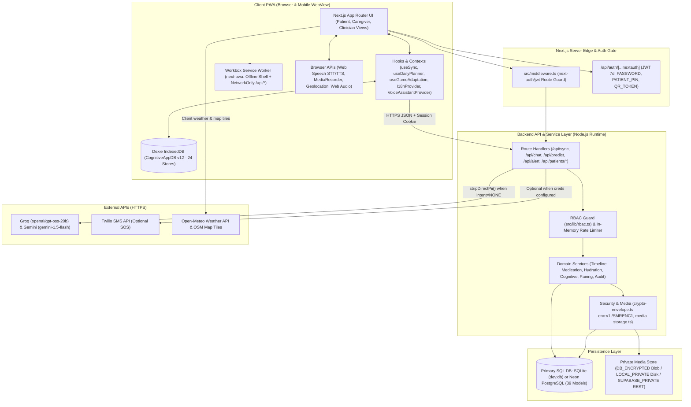

---

# PART 3: MODULE-WISE DESIGN

## Module 1: User Interface & Role Dashboards
- **Purpose:** Render tailored experiences for Elderly Patients, Family Caregivers, and Clinicians.
- **Responsibilities:** Enforce complexity modes (`SIMPLE`/`GUIDED`/`FULL`), apply accessibility overrides (`textScale`, `highContrast`, `reducedMotion`), switch bottom navigation per portal, and gate caregiver settings via PIN lock.
- **Input:** Active NextAuth session, `PatientPreference`, `useDailyPlanner` schedule, clinical/wellbeing API payloads.
- **Processing Logic:** `src/app/page.tsx` branches dashboard cards on `complexityMode`; `/caregiver` renders 8 portal modules; `/doctor` renders 5 analytical tabs with Recharts graphs.
- **Output:** Accessible touch UI (>= 56px targets), CSV downloads, printable A4 views (`/caregiver/routines`, `/doctor`), SOS modals.
- **Dependencies:** `ClientProviders`, `BottomNav`, `NowCard`, `PlannerTimeline`, `MapView`, `recharts`.
- **Relevant Source Files:** `src/app/page.tsx`, `src/app/caregiver/page.tsx`, `src/app/doctor/page.tsx`, `src/components/layout/BottomNav.tsx`, `src/components/layout/ClientProviders.tsx`.
- **Implementation Status:** **Implemented** *(Note: CSS utility classes like `mint-700`/`border-3` appear in JSX without matching definitions in `tailwind.config.ts`).*

## Module 2: User Profile, Pairing & Onboarding
- **Purpose:** Manage caregiver/clinician registration, passwordless elder provisioning, 6-digit clinician/caregiver pairing, and self-service profile updates.
- **Responsibilities:** Validate registration inputs, gate clinician creation via `CLINICIAN_INVITE_CODE`, issue `SMR-XXXXXX` codes + 24h `PatientProvisionToken`s, pair caregivers/clinicians, and handle permanent deletion.
- **Input:** Form submissions on `/register`, `/profile`, `/caregiver`, `/caregiver/settings`, `/doctor`.
- **Processing Logic:** `POST /api/auth/register` rejects `PATIENT` self-signup (`403`) and validates `CLINICIAN_INVITE_CODE` with `safeCompareSecrets`. `POST /api/caregiver/patients` creates patient user + encrypted profile + hashed QR token atomically. `PairingService` manages 24h 6-digit codes.
- **Output:** Created profiles, encrypted PII fields, 24h pairing/QR links, cascade account deletion.
- **Dependencies:** `PairingService`, `AuditService`, `crypto-envelope.ts`, `bcryptjs`.
- **Relevant Source Files:** `src/app/api/auth/register/route.ts`, `src/app/api/caregiver/patients/route.ts`, `src/services/pairing.service.ts`, `src/app/api/account/delete/route.ts`, `src/components/caregiver/CaregiverPatientBar.tsx`.
- **Implementation Status:** **Implemented** *(Partially wired: `DeviceSession` is revoked in `onboarding/route.ts` but never created/checked on JWT validation).*

## Module 3: Cognitive Gaming Engine
- **Purpose:** Deliver 14 dementia-friendly cognitive exercises spanning memory, attention, language, visuospatial, executive, and social stimulation.
- **Responsibilities:** Render game boards, play Web Audio feedback tones, read prompts aloud (subset), load family photo/audio assets (`guess-faces`, `recognize-voices`), and log session telemetry.
- **Input:** User taps, active `patientId`, `preferences.culturalPackId`, `FamilyAsset` rows, `useI18n`.
- **Processing Logic:** Hub routes `/games` -> 14 dedicated Next.js pages; 10 games wrap inside `GameContainer`, while 4 (`guess-faces`, `recognize-voices`, `pattern-weave`, `word-garden`) render custom shells.
- **Output:** Interactive round completion, local `db.gameLogs`, remote `CognitiveSession` records.
- **Dependencies:** `GameContainer`, `logCognitiveSession`, `playFanfareSound`, `regional-content.ts`.
- **Relevant Source Files:** `src/app/games/page.tsx`, `src/components/games/GameContainer.tsx`, `src/lib/cognitive-logger.ts`, `src/app/games/*/page.tsx` (14 files).
- **Implementation Status:** **Partially Implemented (Telemetry Inconsistency)** *(All 14 games are playable, but 7 rely on `GameContainer` default `skipAutoLog=false` logging static dummy metrics `{moves: 4, errors: 0, accuracy: 1, difficultyLevel: 1}`, 2 hardcode `errors: 0, accuracy: 1`, and only 1 respects `culturalPackId` dynamically).*

## Module 4: Game Difficulty Adaptation
- **Purpose:** Automatically scale challenge parameters (`1..10`) based on errors and latency to avoid frustration in dementia users.
- **Responsibilities:** Track per-move timing and errors, display subtle hints after `>= 3` errors (`showHint` for `2000ms`), and adjust next-round `difficultyLevel`, `gridSize`, or `optionsCount`.
- **Input:** `currentDifficulty`, `timeTaken` (seconds), `errors`, `expectedTimePerLevel = 20 + difficultyLevel * 5`.
- **Processing Logic:** Deterministic heuristic in `calculateNextDifficulty()` (`performanceScore = -(errors * 1.5) - ((timeTaken - expected) / expected)`). Shifts `+1` if `> 0.5`, `-1` if `< -1.5`.
- **Output:** `{ newDifficulty, reasoning, gridSize, optionsCount }` + logged `CognitiveSession`.
- **Dependencies:** `useGameAdaptation`, `calculateNextDifficulty`, `logCognitiveSession`.
- **Relevant Source Files:** `src/lib/ai-difficulty.ts`, `src/hooks/useGameAdaptation.ts`, `src/app/games/memory-match/page.tsx`, `src/app/games/find-the-item/page.tsx`.
- **Implementation Status:** **Partially Implemented** *(Engine and API schema work `1..10`, but only **2/14** games wire `useGameAdaptation`; secondary domain shift from `CognitiveService.logSession` is unconsumed by UI).*

## Module 5: Memory Assessment, Wellbeing & Progress Tracking
- **Purpose:** Record subjective wellbeing check-ins, caregiver observations, clinical vitals, and surface non-diagnostic trend visibility.
- **Responsibilities:** Run patient 6-question check-ins (`/check-in`), log caregiver observations (`/caregiver/wellbeing`) and vitals (`/caregiver`), compute rule-based engagement indicator (`/api/predict`), and merge longitudinal timelines.
- **Input:** `WellbeingEntry` (`0..3` or `-1` skip), `VitalLog`, `CaregiverReport`, `SleepRecord`, `ActivityRecord`, `CognitiveSession`, `MedicationEvent`.
- **Processing Logic:** `TimelineService` decrypts notes and aggregates 5 record models; `POST /api/predict` sums 3 heuristic rules (reaction time, errors, 7-day med adherence) into `0..100`.
- **Output:** Unified timeline, 7-day heatmap rows, Recharts trends, CSV exports, non-diagnostic indicator JSON.
- **Dependencies:** `TimelineService`, `CognitiveService`, `crypto-envelope.ts`, `recharts`.
- **Relevant Source Files:** `src/app/check-in/page.tsx`, `src/app/caregiver/wellbeing/page.tsx`, `src/services/timeline.service.ts`, `src/app/api/predict/route.ts`.
- **Implementation Status:** **Implemented** *(Note: `HealthScore` and `MoodRecord` models exist, though `/doctor` primarily renders `CognitiveSession`, `VitalLog`, `MedicationEvent`, and `WellbeingEntry`; predictive indicator is strictly rule-based rather than ML).*

## Module 6: AI Assistant & Voice Interaction
- **Purpose:** Provide a calm voice-first and text companion grounded in the user's real schedule, hydration, and medications without medical hallucination.
- **Responsibilities:** Capture speech/typed input (`ConversationalUI`), parse operational intents (`parseVoiceIntent`), enforce consent/PII redaction, route unmatched queries to LLM or deterministic fallback, and synthesize spoken replies.
- **Input:** Speech/text utterance, last 6 chat turns, `lang`, `patientId`, live DB care state.
- **Processing Logic:** `POST /api/chat` runs 9 English regex rules returning verified DB answers (`source: 'verified-record'`); `NONE` invokes `stripDirectPii` + `AI_COMPANION` consent + `20/10m` limit + `resolveAIProvider()`.
- **Output:** Structured `{ reply, source, factGrounded, intent }`, optional navigation/confirmation CTA, `speechSynthesis` audio.
- **Dependencies:** `parseVoiceIntent`, `resolveAIProvider`, `VoiceAssistantProvider`, `offline-voice.ts`.
- **Relevant Source Files:** `src/app/api/chat/route.ts`, `src/lib/ai/intent-parser.ts`, `src/lib/ai/provider.ts`, `src/components/voice/ConversationalUI.tsx`, `src/lib/offline-voice.ts`.
- **Implementation Status:** **Implemented** *(Intent parser matches English regex only; Web Speech covers 5 of 17 locales, with caregiver-recorded audio fallback via `offline-voice.ts`).*

## Module 7: Reminders, Family Voice Prompts & Safety / SOS
- **Purpose:** Schedule daily routines, attach family-recorded audio prompts, monitor consent-based GPS safe zones, and handle SOS requests.
- **Responsibilities:** CRUD `DailyRoutine`/`VoiceReminder`, run proactive `RoutineNotification` popups for `nowItem`, track geofence crossings (`useGeolocationEngine`), and dispatch/audit SOS alerts.
- **Input:** Routine schedules, `MediaRecorder` blobs, browser GPS (`watchPosition`), `POST /api/alert`.
- **Processing Logic:** `useDailyPlanner` merges server routines/meds with Dexie cache and highlights `sortTime <= now + 30m`; `/safety` evaluates Haversine radius with jitter hysteresis; `/alert` calls Twilio if configured else logs `AUDIT_LOGGED_ONLY`.
- **Output:** NowCard reminders, playable `VoiceReminder` audio, geofence events, `tel:` dials, honest SOS status.
- **Dependencies:** `useDailyPlanner`, `useGeolocationEngine`, `geoUtils.ts`, `MapView.tsx`.
- **Relevant Source Files:** `src/hooks/useDailyPlanner.ts`, `src/hooks/useGeolocationEngine.ts`, `src/components/patient/RoutineNotification.tsx`, `src/app/api/patients/[patientId]/safety/route.ts`, `src/app/api/alert/route.ts`, `src/app/api/push/subscribe/route.ts`.
- **Implementation Status:** **Partially Implemented (Push Sending Absent)** *(Geofencing, voice reminders, and Twilio SMS work; Web Push only saves subscriptions—`pushSent` is always `false`).*

## Module 8: Medication & Hydration Tracking
- **Purpose:** Separate clinician prescribing from patient/caregiver dose confirmation, support pill photos, and track daily hydration goals with 1-tap undo.
- **Responsibilities:** Enforce clinician-only prescription writes, attribute medication intake (`PATIENT_REPORTED`, `CAREGIVER_CONFIRMED`, `CLINICIAN_RECORDED`), attach encrypted pill photos, and track hydration ML vs target.
- **Input:** Clinician prescriptions, `NowCard` / Caregiver confirmations, `+1 Glass` (`250 ml`) / `UNDO`.
- **Processing Logic:** `MedicationService` & `HydrationService` mutate records with soft-delete (`status: 'DELETED'`) and `AuditLog`. Server conflict resolution protects `CAREGIVER_CONFIRMED` doses over offline patient writes.
- **Output:** Daily adherence logs, pill thumbnails, hydration percentage bars.
- **Dependencies:** `MedicationService`, `HydrationService`, `media-storage.ts`.
- **Relevant Source Files:** `src/services/medication.service.ts`, `src/services/hydration.service.ts`, `src/app/api/patients/[patientId]/medications/manage/route.ts`, `src/app/api/patients/[patientId]/medications/photo/route.ts`, `src/app/api/patients/[patientId]/hydration/route.ts`.
- **Implementation Status:** **Implemented** *(Minor gap: `/medications/photo` checks `'edit_routines'`, which default clinician scopes omit).*

## Module 9: Cultural, Memories Scrapbook & NER Language Personalization
- **Purpose:** Preserve cultural identity across North East India through regional packs, multi-language translations, Manipuri dual script support, and family photo/voice memories.
- **Responsibilities:** Manage 17 language definitions and honest translation verification badges, resolve Manipuri Bengali vs Meetei Mayek script, supply 8 regional SVG asset packs, and store encrypted family assets/scrapbook entries.
- **Input:** `preferredLanguage`, `scriptPreference`, `culturalPackId`, uploaded images/voice clips.
- **Processing Logic:** `I18nProvider` wraps translations via `Proxy` fallback to English (`createFallbackTranslation`). `getCulturalPack()` selects state SVG objects. Media routes compress & AES-GCM encrypt assets.
- **Output:** Localized UI, Manipuri dual-script rendering, digital scrapbook, `Guess the Faces` / `Whose Voice?` content.
- **Dependencies:** `I18nProvider`, `NER_LANGUAGE_CATALOG`, `NER_REGIONAL_PACKS`, `locale-format.ts`.
- **Relevant Source Files:** `src/contexts/I18nProvider.tsx`, `src/lib/i18n/metadata.ts`, `src/lib/translations.ts`, `src/lib/regional-content.ts`, `src/app/scrapbook/page.tsx`.
- **Implementation Status:** **Partially Implemented (Content Review Status)** *(Catalog infrastructure and 8 state packs are fully wired; 16 non-English translations remain marked `NEEDS_NATIVE_REVIEW`, `PARTIAL_STARTER`, or `UNTRANSLATED_PLACEHOLDER` awaiting native review).*

## Module 10: Database, Offline Cache & Sync Management
- **Purpose:** Persist unified clinical/daily care state locally for zero-connectivity use and synchronize deterministically with remote SQL when online.
- **Responsibilities:** Maintain 39 Prisma models (SQLite + PostgreSQL parity) and 24 Dexie stores, run online/mount batch pushes, deduplicate mutations via `SyncMutation`, and resolve routine/medication conflicts.
- **Input:** Offline Dexie rows (`synced: false`), online reconnect triggers (`useSync`), JSON import/export.
- **Processing Logic:** `POST /api/sync` processes up to 50 items per bucket transactionally via `clientMutationId`, returning conflict notices when server state outranks patient offline writes.
- **Output:** Synced DB records, `SyncMutation` audit logs, conflict-free daily schedules.
- **Dependencies:** `prisma.ts`, `db.ts`, `useSync.ts`, `vercel-build.mjs`.
- **Relevant Source Files:** `prisma/schema.prisma`, `prisma/postgres/schema.prisma`, `src/lib/db.ts`, `src/hooks/useSync.ts`, `src/app/api/sync/route.ts`.
- **Implementation Status:** **Partially Implemented** *(Offline push works cleanly, but `useSync.pullDeltaToCache` currently saves only `patientPreferences` from `GET /api/sync` and skips pushing `db.routineOccurrences`; `offline-crypto.ts` string encryption is not wired into `db.ts` reads/writes).*

## Module 11: Authentication, RBAC & Data Protection
- **Purpose:** Isolate patient health records across roles, enforce consent scopes, encrypt sensitive fields/media at rest, and preserve audit trails.
- **Responsibilities:** Verify JWT/credentials/PIN lockouts, authorize every API call via `RBAC`, enforce AES-256-GCM server encryption (`enc:v1:` / `SMRENC1`), redact outbound LLM PII, and record `AuditLog` entries.
- **Input:** Cookies/JWTs, login credentials, `ENCRYPTION_MASTER_KEY`, consent toggles.
- **Processing Logic:** Fail-closed env getters (`env.ts`), constant-time comparisons, AAD-bound `patientId` GCM tags, role & `CareCircleMember` JSON permission sets.
- **Output:** Protected endpoints (`401`/`403`), encrypted columns/files, redacted logs.
- **Dependencies:** `auth.ts`, `middleware.ts`, `rbac.ts`, `env.ts`, `crypto-envelope.ts`, `media-storage.ts`, `rate-limit.ts`.
- **Relevant Source Files:** `src/lib/auth.ts`, `src/lib/rbac.ts`, `src/lib/crypto-envelope.ts`, `src/lib/media-storage.ts`, `src/app/api/patients/[patientId]/consents/route.ts`.
- **Implementation Status:** **Implemented (with noted hardening gaps)** *(CSRF relies on NextAuth cookies; rate-limiter is in-memory `Map`; `retentionDays` has no scheduled purge; some consent scopes are informational only).*

## Module 12: Analytics & Clinical / Caregiver Reporting
- **Purpose:** Surface clear, printable, exportable engagement, adherence, and symptom trends to caregivers and clinicians.
- **Responsibilities:** Plot cognitive accuracy & vital trends via Recharts, generate 7-day color-coded wellbeing trend grids, export CSV/JSON patient bundles, and format printable clinical summaries.
- **Input:** `TimelineItem[]`, `VitalLog[]`, `CognitiveSession[]`, `WellbeingEntry[]`, `/api/predict` output.
- **Processing Logic:** Client formatting in `/doctor`, `/caregiver`, `/caregiver/wellbeing`, and `/caregiver/settings` generates downloadable CSV/JSON blobs and A4 CSS print layouts.
- **Output:** Interactive charts, CSV reports (`/wellbeing`, `/doctor`), full JSON export (`/caregiver/settings`), print reports.
- **Dependencies:** `recharts`, `TimelineService`, `CognitiveService`, `predict/route.ts`.
- **Relevant Source Files:** `src/app/doctor/page.tsx`, `src/app/caregiver/wellbeing/page.tsx`, `src/app/caregiver/settings/page.tsx`.
- **Implementation Status:** **Implemented**.

---

# PART 4: DATA FLOW DIAGRAMS

## 4.1 Level 0: Context Diagram

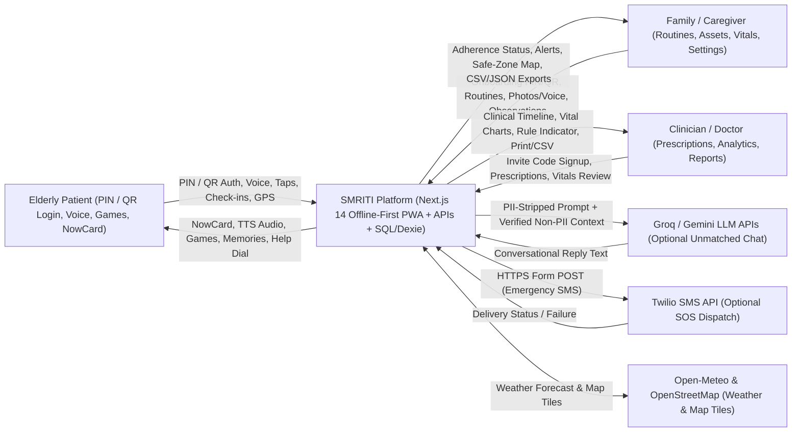

## 4.2 Level 1: Overall Data Flow Diagram

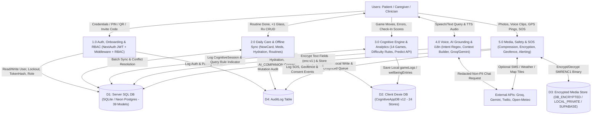

## 4.3 Level 2: Key Internal Workflows (Offline Sync, Encryption & AI Grounding)

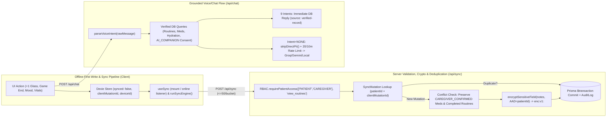

---

# PART 5: WORKFLOW AND PROCESS DIAGRAMS

## 5.1 Workflow 1: User Registration & Multi-Mode Login

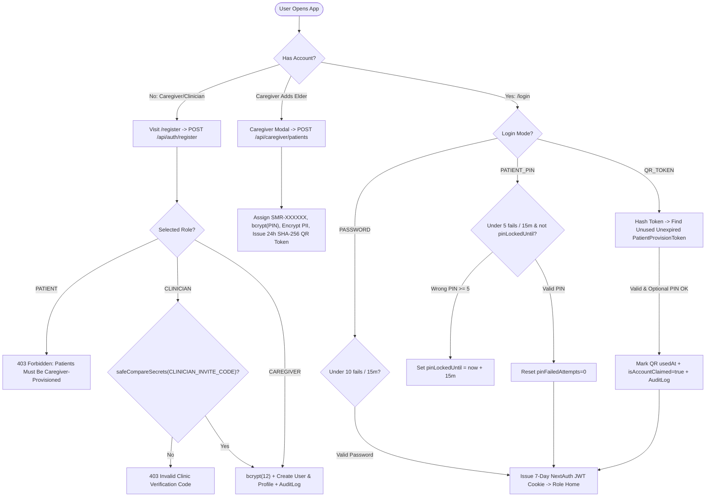

## 5.2 Workflow 2: User Dashboard Execution

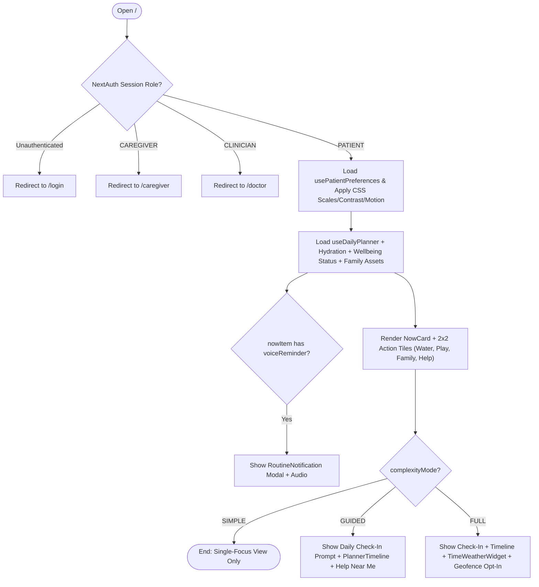

## 5.3 Workflow 3: Cognitive Game Execution

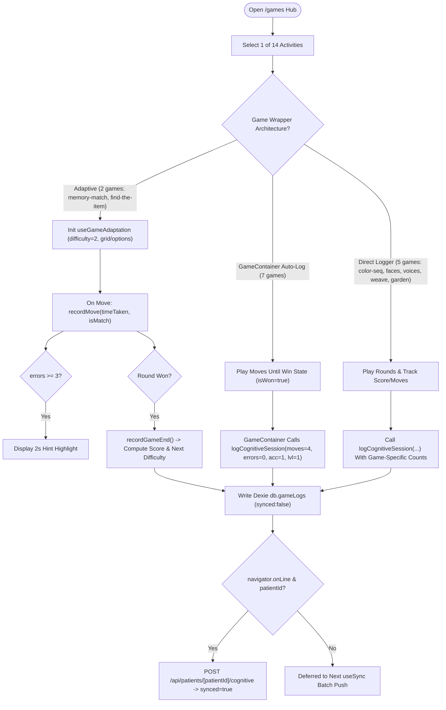

## 5.4 Workflow 4: Adaptive Difficulty Mechanism

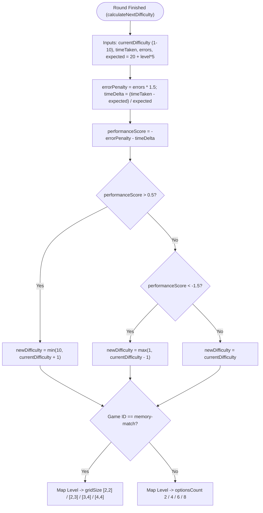

## 5.5 Workflow 5: AI Assistant Voice & Text Interaction

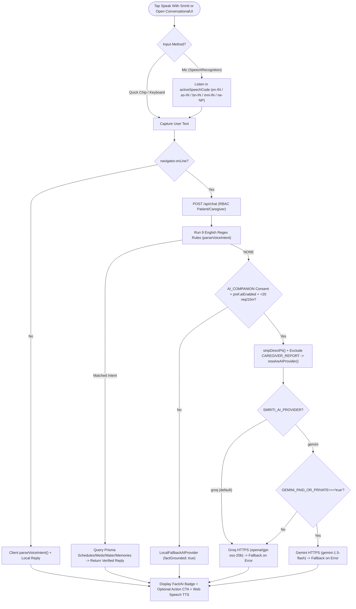

## 5.6 Workflow 6: Reminder, Medication Attribution & Hydration Tracking

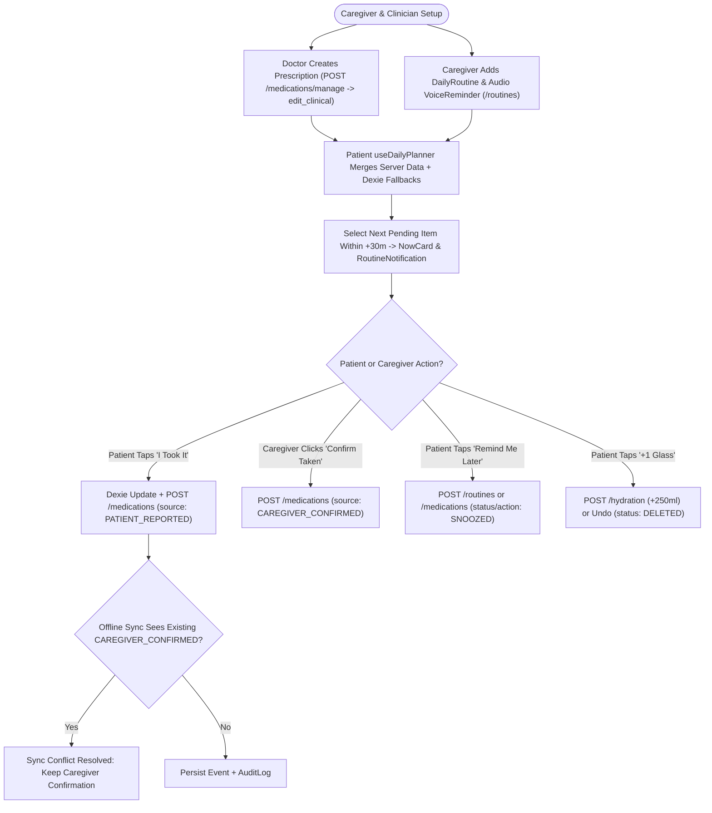

## 5.7 Workflow 7: Progress Storage, Retrieval & Proposed Retention Purge

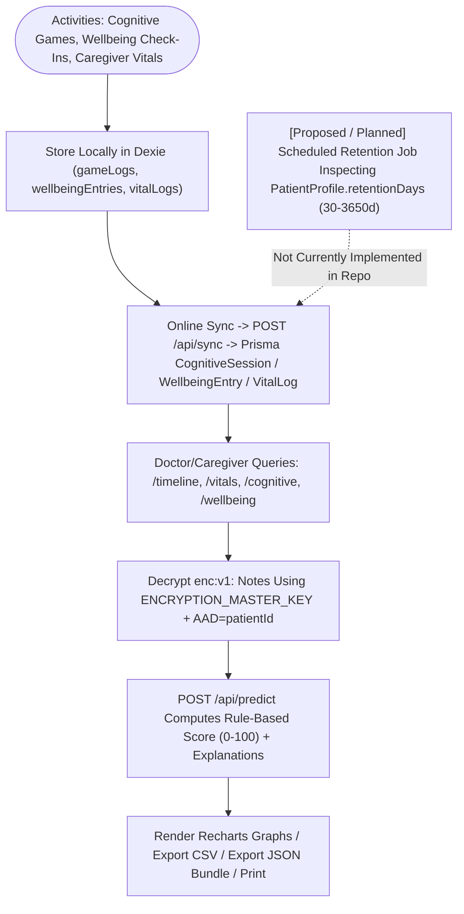

---

# PART 6: DATABASE DESIGN

## 6.1 Database Technologies & Dual-Schema Strategy
1. **Remote / Production RDBMS:** **PostgreSQL** (`prisma/postgres/schema.prisma`) deployed on **Neon Serverless Postgres** (`aws-ap-southeast-1`) using `DATABASE_URL` (PgBouncer pooled) for runtime queries and `DIRECT_URL` (unpooled) for `prisma migrate deploy` (`0001_init/migration.sql`).
2. **Local / CI RDBMS:** **SQLite** (`prisma/schema.prisma`, `prisma/dev.db`) with 3 sequential migrations (`0000_baseline`, `0001_v1_foundations`, `0002_media_encrypted_blob`). All 39 model names, column types, constraints, and relations are identical between SQLite and PostgreSQL.
3. **Offline Client Store:** **IndexedDB** via Dexie v4 (`CognitiveAppDB` v12 in `src/lib/db.ts`) maintaining **24 object stores** with `synced` flags and `clientMutationId` keys.

## 6.2 Complete Server Schema Inventory (39 Prisma Models)

All primary keys are `id String @id @default(uuid())`. Unless noted, FKs specify `onDelete: Cascade`.

| Domain | Model | Key Columns & Types | FKs / Uniques / Indexes |
|---|---|---|---|
| **Auth** | `User` | `email` (Unique), `loginCode?` (Unique), `passwordHash`, `pinHash?`, `pinFailedAttempts`, `pinLockedUntil?`, `role`, `createdByCaregiverId?`, `isActive` | Root identity (`PATIENT`, `CAREGIVER`, `CLINICIAN`) |
| **Auth** | `PatientProfile` | `userId` (Unique), `fullName`, `dateOfBirth?`, `bloodGroup?`, `emergencyContact?` (enc), `preferredLanguage`, `diagnoses?` (enc), `allergies?` (enc), `dietaryRestrictions?`, `cognitiveBaseline?`, `mobilityInfo?`, `isAccountClaimed`, `retentionDays` (`730`) | FK `userId -> User.id` |
| **Auth** | `CaregiverProfile` | `userId` (Unique), `fullName`, `phoneNumber?` | FK `userId -> User.id` |
| **Auth** | `ClinicianProfile` | `userId` (Unique), `fullName`, `specialization?`, `hospital?` | FK `userId -> User.id` |
| **Access** | `PatientCaregiver` | `patientId`, `caregiverId`, `status` | `@@unique([patientId, caregiverId])`, `@@index([caregiverId, status])` |
| **Access** | `CareCircleMember` | `patientId`, `caregiverId?`, `clinicianId?`, `role`, `permissions` (JSON string), `status` | Indexes on `(patientId,status)`, `(caregiverId,status)`, `(clinicianId,status)` |
| **Access** | `PairingInvitation` | `caregiverId`, `code` (Unique), `status`, `expiresAt` | FK `caregiverId -> CaregiverProfile.id`; `@@index([caregiverId, status])` |
| **Access** | `PatientProvisionToken` | `patientId`, `caregiverId`, `tokenHash` (Unique), `expiresAt`, `usedAt?` | `@@index([patientId, expiresAt])` |
| **Access** | `ConsentRecord` | `patientId`, `grantedByUserId`, `scope`, `granted` (Bool), `authorityType`, `version`, `notes?` | `@@index([patientId, scope, createdAt])` |
| **Access** | `DeviceSession` | `userId`, `deviceId`, `label?`, `revokedAt?`, `lastSeenAt` | FK `userId -> User.id`; `@@index([userId, revokedAt])` |
| **Clinical** | `Medication` | `patientId`, `clinicianId?` (`SetNull`), `name`, `dosage`, `frequency`, `time?`, `instructions?`, `imageUrl?`, `mediaAssetId?`, `status` | `@@index([patientId, status])` |
| **Clinical** | `MedicationEvent` | `patientId`, `medicationId`, `scheduledTime`, `actualTime?`, `action`, `status`, `recordedByUserId?`, `source`, `clientMutationId?`, `deviceId?` | FKs `patientId`, `medicationId`; indexes on `(patientId,scheduledTime,status)`, `(medicationId,status)` |
| **Clinical** | `HydrationTarget` | `patientId`, `targetMl` (Int), `effectiveFrom` | `@@index([patientId, effectiveFrom])` |
| **Clinical** | `HydrationEvent` | `patientId`, `amountMl` (Int), `timestamp`, `status`, `clientMutationId?`, `deviceId?` | `@@index([patientId, timestamp, status])` |
| **Clinical** | `VitalLog` | `patientId`, `weight?` (Float), `sysBp?`, `diaBp?`, `heartRate?`, `clientMutationId?`, `deviceId?`, `recordedAt` | `@@index([patientId, recordedAt])` |
| **Clinical** | `SleepRecord` | `patientId`, `date`, `durationMins`, `interruptions?`, `qualityScore?`, `source` | `@@index([patientId, date])` |
| **Clinical** | `ActivityRecord` | `patientId`, `activityType`, `durationMins`, `steps?`, `date`, `source` | `@@index([patientId, date])` |
| **Clinical** | `MoodRecord` | `patientId`, `moodScore`, `note?`, `clientMutationId?`, `deviceId?`, `recordedAt` | `@@index([patientId, recordedAt])` |
| **Clinical** | `WellbeingEntry` | `patientId`, `date`, `timestamp`, `recordedBy`, `source`, `mood`, `sleepQuality`, `confusionLevel`, `energyLevel`, `painLevel`, `overallWellbeing`, `notes?` (enc), `clientMutationId?`, `deviceId?` | `@@index([patientId, date])` |
| **Clinical** | `CaregiverReport` | `patientId`, `caregiverId`, `reportType`, `appetite?`, `sleep?`, `notes?` (enc), `clientMutationId?`, `deviceId?` | FKs `patientId`, `caregiverId`; `@@index([patientId, createdAt])` |
| **Routine** | `DailyRoutine` | `patientId`, `category`, `title`, `time`, `iconEmoji`, `color`, `assignedTo?`, `voiceReminderId?`, `isActive` | `@@index([patientId, isActive])` |
| **Routine** | `RoutineOccurrence` | `routineId`, `patientId`, `date`, `status`, `completedAt?`, `completedBy?`, `assignedTo?` | `@@unique([routineId, date])`, `@@index([patientId, date])` |
| **Routine** | `VoiceReminder` | `patientId`, `routineType`, `title`, `time`, `speakerName`, `audioBase64`, `mediaAssetId?`, `isActive` | `@@index([patientId, isActive])` |
| **Prefs** | `PatientPreference` | `patientId` (Unique), `complexityMode`, `scriptPreference?`, `culturalPackId`, `reducedMotion`, `highContrast`, `textScale`, `voiceEnabled`, `voiceRate`, `aiEnabled`, `aiInteractionStyle`, `caregiverLockEnabled`, `caregiverLockPinHash?`, `updatedByUserId?` | FK `patientId -> PatientProfile.id` |
| **Games** | `CognitiveSession` | `patientId`, `gameId`, `domain`, `difficultyLevel`, `score`, `accuracy`, `reactionTimeMs?`, `errors`, `clientMutationId?`, `deviceId?`, `completedAt` | `@@index([patientId, domain, completedAt])` |
| **Games** | `HealthScore` | `patientId`, `weekStartDate`, `overallScore`, `cognitiveSub`, `physicalSub`, `sleepSub`, `socialSub` | `@@index([patientId, weekStartDate])` |
| **Games** | `ContentItem` | `title`, `contentType`, `domain?`, `payload`, `status`, `version` | Standalone (no FKs/indexes; currently unused by UI) |
| **Safety** | `SafeZone` | `patientId`, `name`, `lat`, `lng`, `radius`, `isActive` | `@@index([patientId, isActive])` |
| **Safety** | `LocationPing` | `patientId`, `lat`, `lng`, `accuracy`, `status`, `insideZoneId?`, `clientMutationId?`, `deviceId?`, `recordedAt` | `@@index([patientId, recordedAt])` |
| **Safety** | `LocationEvent` | `patientId`, `eventType`, `zoneId?`, `lat?`, `lng?`, `accuracy?`, `timestamp` | `@@index([patientId, timestamp])` |
| **Circle** | `CareUpdate` | `patientId`, `authorId`, `authorName`, `content`, `type`, `timestamp` | `@@index([patientId, timestamp])` |
| **Media** | `FamilyAsset` | `patientId`, `name`, `relation`, `phoneNumber?`, `allowCall`, `requireCallConfirm`, `contributorUserId?`, `visibilityScope`, `imageBase64?`, `audioBase64?`, `mediaPhotoId?`, `mediaAudioId?`, `isActive` | `@@index([patientId, isActive])` |
| **Media** | `ScrapbookEntry` | `patientId`, `title`, `description`, `imageBase64?`, `audioBase64?`, `mediaPhotoId?`, `mediaAudioId?`, `contributorUserId?`, `contributorName?`, `languageCode?`, `eventDateLabel?`, `locationLabel?`, `visibilityScope`, `dateAdded` | `@@index([patientId, dateAdded])` |
| **Media** | `MediaAsset` | `patientId`, `uploadedByUserId?`, `category`, `storageProvider`, `storageKey`, `mimeType`, `sizeBytes`, `sha256?`, `encrypted`, `encryptedBlob` (`Bytes?` / `BYTEA` / `BLOB`) | `@@index([patientId, category])` |
| **Help** | `LocalResource` | `name`, `category`, `description`, `state`, `district`, `locality`, `address`, `phone`, `emergencyPhone?`, `openingHours`, `verificationStatus`, `telehealthAvailable`, `homeVisitAvailable` | `@@unique([name, district])`, `@@index([category, district])` |
| **Help** | `SavedResource` | `patientId`, `resourceId`, `notes?`, `savedAt` | FKs `patientId`, `resourceId`; `@@unique([patientId, resourceId])` |
| **System** | `SyncMutation` | `patientId`, `clientMutationId`, `deviceId`, `recordType`, `entityId?`, `status`, `conflictDetail?`, `clientCreatedAt?` | `@@unique([patientId, clientMutationId])`, `@@index([patientId, createdAt])` |
| **System** | `PushSubscription` | `userId`, `endpoint` (Unique), `p256dh`, `auth`, `userAgent?` | FK `userId -> User.id`; `@@index([userId])` |
| **System** | `AuditLog` | `userId?` (`SetNull`), `action`, `resource`, `resourceId?`, `prevValue?`, `newValue?` | `@@index([userId, createdAt])` |

## 6.3 Entity Relationship Diagram (ERD)

```mermaid
erDiagram
    User ||--o| PatientProfile : "has (PATIENT)"
    User ||--o| CaregiverProfile : "has (CAREGIVER)"
    User ||--o| ClinicianProfile : "has (CLINICIAN)"
    User ||--o{ AuditLog : "writes"
    User ||--o{ DeviceSession : "tracks"
    User ||--o{ PushSubscription : "registers"

    PatientProfile ||--o| PatientPreference : "configures"
    PatientProfile ||--o{ PatientProvisionToken : "issues"
    PatientProfile ||--o{ ConsentRecord : "records"
    PatientProfile ||--o{ SyncMutation : "deduplicates"
    PatientProfile ||--o{ MediaAsset : "owns encrypted"

    PatientProfile ||--o{ PatientCaregiver : "links"
    CaregiverProfile ||--o{ PatientCaregiver : "pairs"
    CaregiverProfile ||--o{ PairingInvitation : "generates"
    CaregiverProfile ||--o{ CaregiverReport : "authors"

    PatientProfile ||--o{ CareCircleMember : "includes"
    CaregiverProfile ||--o{ CareCircleMember : "participates"
    ClinicianProfile ||--o{ CareCircleMember : "participates"

    PatientProfile ||--o{ Medication : "assigned"
    ClinicianProfile ||--o{ Medication : "prescribes"
    Medication ||--o{ MedicationEvent : "logs"
    PatientProfile ||--o{ MedicationEvent : "adherence"

    PatientProfile ||--o{ DailyRoutine : "schedules"
    DailyRoutine ||--o{ RoutineOccurrence : "tracks daily"
    PatientProfile ||--o{ RoutineOccurrence : "completes"
    PatientProfile ||--o{ VoiceReminder : "hears"

    PatientProfile ||--o{ HydrationTarget : "targets"
    PatientProfile ||--o{ HydrationEvent : "drinks"
    PatientProfile ||--o{ VitalLog : "measures"
    PatientProfile ||--o{ SleepRecord : "logs"
    PatientProfile ||--o{ ActivityRecord : "logs"
    PatientProfile ||--o{ MoodRecord : "logs"
    PatientProfile ||--o{ WellbeingEntry : "reports"
    PatientProfile ||--o{ CaregiverReport : "observed in"
    PatientProfile ||--o{ CognitiveSession : "plays"
    PatientProfile ||--o{ HealthScore : "aggregates"

    PatientProfile ||--o{ SafeZone : "defines"
    PatientProfile ||--o{ LocationPing : "emits"
    PatientProfile ||--o{ LocationEvent : "triggers"
    PatientProfile ||--o{ CareUpdate : "receives"
    PatientProfile ||--o{ FamilyAsset : "remembers"
    PatientProfile ||--o{ ScrapbookEntry : "curates"

    LocalResource ||--o{ SavedResource : "bookmarked by"
    PatientProfile ||--o{ SavedResource : "bookmarks"
```

## 6.4 Data Persistence & Local vs. Remote Strategy
- **Dual Persistence:** Interactive writes save to Dexie first (`synced: false`) when triggered inside offline-capable flows (`hydrationEvents`, `medicationEvents`, `gameLogs`, `wellbeingEntries`, `caregiverReports`, `vitalLogs`, `moods`, `currentLocation`, `routines`, `scrapbook`, `familyAssets`). Online calls write immediately to Prisma and set `synced: true`.
- **Dexie Stores (24 total in `v12`):** `tasks`, `gameLogs`, `moods`, `scrapbook`, `patientProfiles`, `vitalLogs`, `prescriptions`, `caregiverReports`, `clinicalVisits`, `hydrationEvents`, `medicationEvents`, `voiceReminders`, `dailyRoutines`, `routineOccurrences`, `safeZones`, `locationEvents`, `currentLocation`, `careCircleMembers`, `careUpdates`, `wellbeingEntries`, `localResources`, `savedResources`, `familyAssets`, `patientPreferences`.
- **Offline Encryption Gap:** Server SQL stores AES-256-GCM envelopes (`enc:v1:` and `SMRENC1`), whereas client IndexedDB stores remain unencrypted because `encryptOfflineString()`/`decryptOfflineString()` in `src/lib/offline-crypto.ts` have zero callers in `src/`.

---

# PART 7: AI / ML DESIGN

## 7.1 Conventional Logic vs. Genuine LLM Inference

| Capability | Classification | Exact Implementation |
|---|---|---|
| **Conversational Chat Fallback** | **Genuine External LLM Inference** | `GroqAIProvider` (`openai/gpt-oss-20b`, `temp=0.45`, `max=320`) & `GeminiAIProvider` (`gemini-1.5-flash`, gated on `GEMINI_PAID_OR_PRIVATE==='true'`) in `src/lib/ai/provider.ts` |
| **Voice / Chat Intent Routing** | **Conventional Rule-Based** | 9 English regex patterns evaluated in priority order in `src/lib/ai/intent-parser.ts` |
| **Care Context Grounding** | **Deterministic SQL Prompt Injection (Not Vector RAG)** | Parallel Prisma queries (`TimelineService`, `MedicationService`, `HydrationService`, `dailyRoutine`, `scrapbookEntry`) + `stripDirectPii()` in `src/app/api/chat/route.ts`; zero embeddings or vector stores |
| **Engagement / Risk Indicator** | **Conventional Heuristic Scoring** | Deterministic threshold formula on reaction time, error rate, and 7-day med adherence (`0..100`) in `src/app/api/predict/route.ts` |
| **Adaptive Game Difficulty** | **Conventional Heuristic Rule** | Weighted penalty score (`-(errors*1.5) - timeDelta`) on `1..10` scale in `src/lib/ai-difficulty.ts` (comments mention RL/Bayesian/EMA simulation, not implemented) |
| **Speech Recognition & Readout** | **Browser OS / Web Speech API + Manual Recording Fallback** | `SpeechRecognition` / `webkitSpeechRecognition` + `speechSynthesis` (`5` speech-coded languages) + caregiver `MediaRecorder` phrases in `src/lib/offline-voice.ts` |

## 7.2 Prompt Engineering & Privacy Boundaries
`buildSystemPrompt()` in `src/lib/ai/provider.ts` injects:
1. Target language (`preferredLanguageName`) and brevity rule (`TASK_FOCUSED`: 1-2 sentences; else 1-3 sentences).
2. Explicit clinical/safety guardrails forbidding diagnosis, medication dosage advice, unverified family facts, false medication `TAKEN` assertions, and false SOS confirmations.
3. Non-PII hydration metrics and up to 8 timeline event summaries with `CAREGIVER_REPORT` rows omitted and `stripDirectPii()` stripping email addresses (`[email-redacted]`), phone strings (`[phone-redacted]`), and lat/lng coordinates (`[location-redacted]`).
4. Last 6 history messages forwarded for Groq; Gemini receives a single prompt string (`system + user`).
5. Consent & rate control: if `AI_COMPANION` consent is denied, `pref.aiEnabled === false`, or `ai-chat:${patientId}` exceeds `20` requests per `10` minutes, `POST /api/chat` routes directly to `LocalFallbackAIProvider`.

## 7.3 Cognitive Assessment & Adaptive Algorithm Formulas
- **Engagement Indicator (`POST /api/predict`):**
  - Uses last `<= 20` supplied `gameLogs` or last `10` DB `CognitiveSession` records + 7-day `ACTIVE` `MedicationEvent` rows.
  - Additive rule weights (`indicatorScore` clamped `0..100`):
    - Mean move latency: `> 15s` adds `+35`; `> 10s` adds `+18`.
    - Mean session errors: `> 4` adds `+30`; `> 2` adds `+15`.
    - 7-day medication adherence `< 70%` adds `+25`.
  - Labels: `> 65` -> `'High Attention Needed'`, `> 30` -> `'Moderate'`, else `'Low'`, returning `'Insufficient Data'` (`riskScore: null`) if both datasets are empty.
- **Difficulty Adaptation (`calculateNextDifficulty` & `useGameAdaptation`):**
  - Default start: `difficultyLevel = 2`, `expectedTimePerLevel = 20 + difficultyLevel * 5`.
  - `performanceScore = -(errors * 1.5) - ((timeTaken - expectedTimePerLevel) / expectedTimePerLevel)`.
  - `> 0.5` increments difficulty (`max 10`); `< -1.5` decrements difficulty (`min 1`).
  - `memory-match` maps difficulty `1..10` to `[2,2]`, `[2,3]`, `[3,4]`, `[4,4]` grids; non-match games map to `2/4/6/8` options.

## 7.4 Multilingual & Voice Pipeline Architecture
- **17 Language/Script Catalog Entries** (`LANGUAGES`, `NER_LANGUAGE_CATALOG`, `INTL_LOCALE_MAP`):
  - **5 Web Speech (`speechCode`) locales:** `en` (`en-IN`), `as` (`as-IN`), `bn` (`bn-IN`), `mni` (`mni-IN`), `ne` (`ne-NP`).
  - **12 text/fallback-only entries (no `speechCode`):** `mni-mymk` (Meetei Mayek), `brx`, `kha`, `lus`, `grt`, `njz`, `adi`, `clk`, `njm`, `njo`, `sip`, `trp`.
  - `offlineAsrAvailable` is `false` for all 17 entries.
- **3-Tier Offline Voice Playback (`playRecordedPhraseOrFallback`):**
  1. `RECORDED_AUDIO`: Plays caregiver `MediaRecorder` clip stored in `db.voiceReminders` (`phrase:<CorePhraseKey>`).
  2. `SYNTHESIZED_TTS`: Speaks via `window.speechSynthesis` only if `speechCode` is explicitly defined.
  3. `VISUAL_ONLY`: Renders screen cards without deceptive wrong-language TTS.

## 7.5 AI & Voice Pipeline Diagram

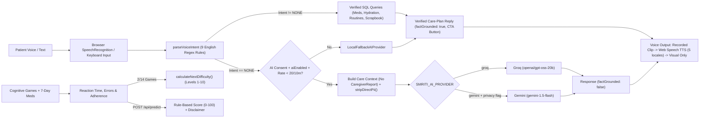

---

# PART 8: UI DESIGN AND WIREFRAMES

## 8.1 Major Screens Inventory

| Route (`src/app/...`) | Purpose | Key UI Components | Access / Gate |
|---|---|---|---|
| `/` | Elderly Patient Home (`SIMPLE`, `GUIDED`, `FULL`) | Top Help SOS & Caregiver Lock buttons, Greeting + Listen + Voice Companion triggers, `NowCard`, 2x2 Action Tiles, Check-In card, `PlannerTimeline`, `TimeWeatherWidget`, `RoutineNotification`, `FamilyCallModal`, `ConversationalUI` | Patient (redirects CG->`/caregiver`, DR->`/doctor`, Unauth->`/login`) |
| `/login` | Multi-mode sign-in | Dual role tabs (`Elder PIN / QR` & `Caregiver / Doctor`), `SMR-XXXXXX` input, 3x4 PIN touch keypad, QR token auto-handler (`?qr=`) | Public |
| `/register` | Self-service onboarding | Name, Email, Password, Role dropdown (`CAREGIVER` / conditional `CLINICIAN` with invite code) | Public (`PATIENT` blocked) |
| `/check-in` | 6-step wellbeing self-report | Progress dots, TTS `Listen` button, large emoji option cards (`0..3`), `Skip`, `Finish Now` | Authenticated (`middleware`) |
| `/scrapbook` | Digital family & cultural memory album | Family quick-faces strip, photo/music memory card, `<ListenButton>`, `MediaRecorder` voice recorder, add/delete modals | Client-loaded (Patient/CG) |
| `/games` + `/games/<14>` | Cognitive games hub & 14 games | Category cards, `GameContainer` modal/back bar, emoji/SVG game grids, `guess-faces` / `recognize-voices` photo/audio drills | Client-loaded |
| `/help-near-me` | Elderly NER resource finder | Search bar, 6 spoken category tiles, verified badges, save bookmark, 1-tap `tel:` call & 112/108 | Auth API backed |
| `/profile` | Account & caregiver pairing | Email/`loginCode` display, profile update form, 6-digit pairing accept/revoke (`PATIENT`) | Authenticated (`middleware`) |
| `/offline` | Offline service worker fallback | Minimal localized offline message + Home link | Public fallback |
| `/caregiver` + 8 subroutes | Caregiver coordination hub & tools | `CaregiverPatientBar` (+ Create Patient modal), Pill confirmation + photo upload, Recharts accuracy chart, Vitals form, 8 subpages (`/routines`, `/wellbeing`, `/circle`, `/safety` w/ Leaflet `MapView`, `/voice`, `/family`, `/resources`, `/settings`) | `CAREGIVER` (`middleware`) |
| `/doctor` | Clinician dashboard | Patient switcher, Assign Patient modal, 5 tabs (`Overview`, `Vitals & Trends`, `Prescriptions`, `Timeline`, `Engagement Analytics`), Recharts graphs, CSV/Print export | `CLINICIAN` (`middleware`) |

## 8.2 Responsive Design & Accessibility Controls
- **Viewport & Layout:** Configured for phones (`360px+`, fluid 2-col patient grids, wrapped clinician tabs, bottom `pb-32`/`pb-36` clearance above `BottomNav` and floating `SpeakButton`) and tablets (`640px+`/`768px+` 2-col portals & games grids).
- **Elder Accessibility (Applied to `<html>` only when `role === 'PATIENT'` in `ClientProviders.tsx`):**
  - `--smriti-text-scale`: `1.0x`, `1.15x`, `1.30x`, `1.45x` scaling root `rem` sizing in `globals.css`.
  - `data-high-contrast="true"`: high-contrast `#0f172a` text & card borders over `#ffffff`.
  - `data-reduced-motion="true"`: CSS `0.01ms` animations + Framer Motion `<MotionConfig reducedMotion="always">`.
  - Minimum `>= 56px` touch targets on patient primary controls (`NowCard`, `BottomNav`, keypad, `Check-In`, `FamilyCallModal`, `SpeakButton`).

## 8.3 UI Navigation Diagram

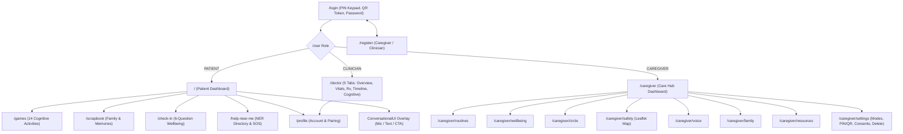

## 8.4 Text Wireframes of Main Screens

**1. Patient Home (`/`, `GUIDED` Mode — Phone `360px`):**
```text
+---------------------------------------+
| [Menu/Lock]                [(SOS)Call]|
|   Good Morning, [Patient Name]        |
|   [ Listen ]   [ Talk to Smriti ]     |
+---------------------------------------+
|  [  NOW: 08:00 Morning Medicine    ]  |
|  [        [ Pill Photo ]           ]  |
|  [ [Play Voice] ]                  |
|  [  I Took It  ]  [ Remind Later ] |
+---------------------------------------+
| +------------------+ +--------------+ |
| | Hydration 25%    | | Play         | |
| | 2 glasses        | | 14 games     | |
| | [+1 Glass] [Undo]| | Start ->     | |
| +------------------+ +--------------+ |
| +------------------+ +--------------+ |
| | Family           | | Get Help     | |
| | Photos & voices  | | Call / 112   | |
| +------------------+ +--------------+ |
+---------------------------------------+
| [Optional Daily Check-In -> Share]    |
| TODAY: [Breakfast 08:30] [Walk 17:00] |
+---------------------------------------+
|  [Today]       [Play]      [Family]   |  <-- BottomNav + Floating (Globe)(Speak)
+---------------------------------------+
```

**2. Login (`/login` — `Elder PIN / QR` Tab):**
```text
+---------------------------------------+
|        SMRITI CARE COMPANION          |
|            Welcome Back               |
| [ Elder PIN / QR ] [Caregiver/Doctor] |
| Code: [ SMR-000000                  ] |
| PIN:  [ • • • •                     ] |
|   [ 1 ]        [ 2 ]        [ 3 ]     |
|   [ 4 ]        [ 5 ]        [ 6 ]     |
|   [ 7 ]        [ 8 ]        [ 9 ]     |
|  [Clear]       [ 0 ]      [ Back ]    |
| [          Open My Smriti           ] |
| Caregiver/Clinician? Create Account   |
+---------------------------------------+
```

**3. Clinical Portal (`/doctor` — Tablet `768px`):**
```text
+-----------------------------------------------------------------------+
| Clinical Portal (Signed in as Dr. X) [Assign] [CSV] [Print] [SignOut] |
| Patient Dropdown: [Patient Name (SMR-XXXXXX)]  [RULE INDICATOR BADGE] |
| Blood Group | Allergies | Emergency | Language                        |
| [Overview] [Vitals & Trends] [Prescriptions] [Timeline] [Analytics]   |
+-----------------------------------------------------------------------+
| ! Supportive Care Summary Only (Non-diagnostic clinical disclaimer)   |
| +-------------------------------+  +--------------------------------+ |
| | LATEST WEIGHT: -- kg          |  | BLOOD PRESSURE: --/--          | |
| +-------------------------------+  +--------------------------------+ |
| +-------------------------------+  +--------------------------------+ |
| | HEART RATE: -- bpm            |  | RULE INDICATOR: -- / 100       | |
| +-------------------------------+  +--------------------------------+ |
| Recent Caregiver Observations: [Latest notes & scores...]             |
+-----------------------------------------------------------------------+
|               [Account]              [Clinical Portal]                |
+-----------------------------------------------------------------------+
```

## 8.5 Verified UI Screenshot Captures
Below are live rendered UI screenshots captured during browser verification (`375x812` mobile live Vercel deployment and `768x1024` tablet clinician portal):

<!-- SCREENSHOT_GALLERY -->

---

# PART 9: COMPONENT DESIGN

## 9.1 Component & Architecture Layers
- **Frontend Providers & Reusable UI:** `ClientProviders` (`AuthProvider`, `I18nProvider`, `VoiceAssistantProvider`, `SyncAndAccessibilityShell`), UI primitives in `src/components/ui/` (`Button.tsx`, `FadeIn.tsx`, `ListenButton.tsx`), Layout (`BottomNav.tsx`, `SpeakButton.tsx`), Patient (`NowCard`, `PlannerTimeline`, `RoutineNotification`, `TimeWeatherWidget`, `FamilyCallModal`), Voice (`ConversationalUI`), Caregiver (`CaregiverPatientBar`, `MapView`), Games (`GameContainer`).
- **State Management:** React Contexts (`I18nProvider`, `VoiceAssistantProvider`, NextAuth `SessionProvider`), `localStorage` (`smriti_active_patient_id`, `ner-app-language`, `ner-app-script`, `smriti_device_id`, `smriti_geo_consent_<id>`), `sessionStorage` (`smriti_wc_wrap`), and reactive IndexedDB subscriptions (`useLiveQuery` in `useDailyPlanner`).
- **Hooks Layer (`src/hooks/`):** `useActivePatient`, `useDailyPlanner`, `useGameAdaptation`, `useGeolocationEngine`, `usePatientPreferences`, `useSync`.
- **Backend Route Handlers, Middleware, RBAC & Services:**
  - `src/middleware.ts` enforces edge JWT + role routing for 6 page paths.
  - `src/lib/rbac.ts` checks DB `User.isActive`, active `PatientCaregiver` / `CareCircleMember` / prescriber `Medication`, and fine-grained `PermissionScope` JSON arrays.
  - 6 Services (`AuditService`, `CognitiveService`, `HydrationService`, `MedicationService`, `PairingService`, `TimelineService`) encapsulate shared domain queries & mutations.
  - Utility modules: `api-errors.ts`, `cognitive-logger.ts`, `crypto-envelope.ts`, `dateUtils.ts`, `env.ts`, `geoUtils.ts`, `locale-format.ts`, `media-compress.ts`, `media-storage.ts`, `offline-crypto.ts`, `offline-voice.ts`, `prisma.ts`, `rate-limit.ts`, `regional-content.ts`, `sound.ts`, `translations.ts`, `ai-difficulty.ts`, `ai/intent-parser.ts`, `ai/provider.ts`.

## 9.2 Component & Service Interaction Diagram

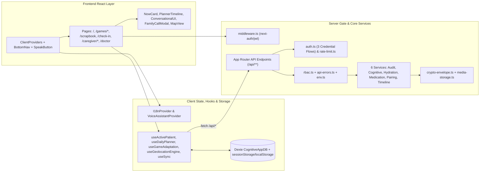

---

# PART 10: SECURITY, RELIABILITY AND DEPLOYMENT

## 10.1 Security & Data Protection Assessment
- **Authentication & PIN Safety:**
  - `getNextAuthSecret()` fails closed if `NEXTAUTH_SECRET` is absent (`<32` chars blocked in production).
  - Passwords and numeric PINs (4-6 digits) hashed with `bcryptjs` (cost factor `12`).
  - Elder PIN logins lock for `15` minutes in DB after `5` wrong attempts (`pinFailedAttempts`, `pinLockedUntil`).
  - Caregiver onboarding QR tokens are SHA-256 hashed (`PatientProvisionToken.tokenHash`), single-use (`usedAt`), and 24-hour expiring.
  - Clinician signup requires `CLINICIAN_INVITE_CODE` checked via `crypto.timingSafeEqual` (`safeCompareSecrets`).
- **Encryption at Rest:**
  - Server fields (`PatientProfile.emergencyContact`, `allergies`, `diagnoses`, `CaregiverReport.notes`, `WellbeingEntry.notes`) encrypted via AES-256-GCM (`enc:v1:<iv>:<tag>:<cipher>`) bound to `patientId` AAD using `ENCRYPTION_MASTER_KEY`.
  - Uploaded photos/audio compressed client-side and encrypted into `SMRENC1` AES-256-GCM binary blobs bound to `media:<patientId>:<mediaId>` AAD.
- **HTTP Hardening (`next.config.mjs`):** `no-store` caching on `/api/*`, `X-Content-Type-Options: nosniff`, `X-Frame-Options: SAMEORIGIN`, strict `Referrer-Policy`, `Permissions-Policy`, and Content-Security-Policy allowing `'self'`, Open-Meteo, and OpenStreetMap tiles.
- **Consent & Attribution:** Explicit `ConsentRecord` checks on `LOCATION_SHARING` (`POST /api/patients/[patientId]/safety`) and `AI_COMPANION` (`POST /api/chat`), plus server-derived medication source attribution (`CAREGIVER_CONFIRMED`, `PATIENT_REPORTED`, `CLINICIAN_RECORDED`).
- **Audit Logging:** `AuditService.log()` persists critical reads/mutations/deletes in `AuditLog` without leaking secrets.

## 10.2 Known Technical & Security Limitations (Verified Gaps)
1. **Unwired Client Cache Encryption:** `offline-crypto.ts` (`wc1:`) is not hooked into Dexie (`db.ts`), leaving offline browser data readable in IndexedDB.
2. **In-Memory Rate Limiter:** `rate-limit.ts` uses a local `Map`, meaning brute-force windows reset across Vercel serverless cold starts and do not apply to `/api/auth/register`, `/api/alert`, `/api/pairing`, or PIN-unlock verification.
3. **No Custom CSRF Headers:** Non-NextAuth APIs rely on session cookie defaults without explicit `Origin` checks or custom CSRF tokens.
4. **JWT Revocation (`DeviceSession`):** `onboarding/route.ts` revokes `DeviceSession` rows, but `auth.ts` and `rbac.ts` neither insert nor check `DeviceSession`; issued 7-day JWTs stay valid until expiration unless `user.isActive` is set `false`.
5. **No Automated Retention Purge:** `PatientProfile.retentionDays` (`30-3650d`) is configurable but not enforced by any background job or endpoint.
6. **Web Push Not Sent:** `/api/push/subscribe` stores subscriptions, but `web-push` is not installed and `/api/alert` hardcodes `pushSent: false`.
7. **Media Orphanage & Partial Sync Pull:** Item-level deletes/updates (`/scrapbook`, `/family-assets`, `/medications/photo`) and `PATIENT` self-deletion (`account/delete`) do not purge `MediaAsset` files/blobs. `useSync.pullDeltaToCache` only stores `patientPreferences` from `GET /api/sync`.
8. **Minor Auth/Scope Edge Cases:** `sync/route.ts` `locationPings` bypass `LOCATION_SHARING` consent check; `routines/route.ts` `OCCURRENCE_STATUS` upsert does not validate `routineId` ownership by `patientId`; `clinician/patients` `POST` does not verify the 6-digit `PairingInvitation` caregiver owns the target patient; `medications/photo` requires `'edit_routines'` omitted from default clinician scopes; `care-updates` `PATCH` lacks `'manage_settings'`; `care-circle` `POST` ignores `clinicianId`.
9. **AI & Gaming Coverage:** Intent regexes (`intent-parser.ts`) match English only; `16/17` language packs remain awaiting native-speaker validation; `12/14` games omit `useGameAdaptation`, and `7/14` log dummy win payloads via `GameContainer`.

## 10.3 Deployment Configuration & Live Readiness
- **Configuration Files:** `vercel.json` triggers `node scripts/vercel-build.mjs`, which auto-detects PostgreSQL (`DATABASE_URL`), maps `DIRECT_URL` (`DATABASE_URL_UNPOOLED` / `POSTGRES_URL_NON_POOLING` / stripping `-pooler.`), runs `prisma generate` + `prisma migrate deploy` on `prisma/postgres/schema.prisma`, optionally seeds demo data only if `SEED_SYNTHETIC_DEMO=1`, and runs `next build` (PWA generation via `next-pwa`).
- **Live Cloud Deployment Status (Verified 26 November 2026):**
  - **Repository:** Pushed to private GitHub repo `https://github.com/fynicious/smriti-ner` (`main`, excluding `.env*`, `prisma/*.db*`, `private_media/`, `.github/workflows/ci.yml`).
  - **Database:** Free **Neon Serverless Postgres** (`wandering-sea-41591984`, `aws-ap-southeast-1` Singapore), migrated cleanly (`0001_init`), **0 initial seeded rows**.
  - **Hosting:** Deployed on **Vercel Hobby (`$0`)** at `https://smriti-ner-theta.vercel.app` with `DB_ENCRYPTED` media storage and `SMRITI_AI_PROVIDER=local`. Live verification passed `HTTP 200` on `/api/health` (`database.status: "connected"`, `engine: "postgresql"`, `configReady: true`), `/login`, `/register`, `/api/auth/csrf`, and `/manifest.json`, and `HTTP 401` fail-closed on unauthenticated API routes (`/api/profile`, `/api/resources`).

---

# PART 11: DESIGN SUMMARY

## 11.1 Complete System Design Summary
SMRITI implements a role-separated, offline-resilient dementia companion built on Next.js 14, Prisma (SQLite/PostgreSQL), Dexie IndexedDB, and NextAuth. Elderly patients interact through simplified dashboards (`NowCard`, hydration, 14 brain activities, scrapbook memories, spoken prompts) accessed via caregiver-provisioned codes/PINs/QR links, while caregivers and clinicians manage daily routines, vitals, consent scopes, geofencing, and prescriptions through dedicated portals.

## 11.2 Major Component Interactions
- `ClientProviders` applies patient-only CSS accessibility vars and orchestrates `useSync` (`POST /api/sync` + `SyncMutation` deduplication + conflict resolution).
- `RBAC` acts as the uniform server gate across 29 API route files, pairing with `crypto-envelope.ts` and `media-storage.ts` to protect PII columns and binary media behind authorized proxy endpoints.
- `POST /api/chat` evaluates deterministic regex intents against live Prisma care data before optionally forwarding PII-scrubbed prompts to Groq or Gemini.

## 11.3 Key Architectural Decisions & Design Advantages
1. **Caregiver-Provisioned Onboarding + Separate Clinical Authority:** Removes email/password barriers for dementia patients while protecting medical prescriptions behind clinician RBAC scopes.
2. **Honest Non-Diagnostic & Fail-Closed Design:** Separates engagement heuristics (`/api/predict`) from clinical diagnosis, reports honest SOS status (`AUDIT_LOGGED_ONLY` vs `CONFIRMED_SMS`), and fails closed without `NEXTAUTH_SECRET` or `ENCRYPTION_MASTER_KEY`.
3. **Serverless-Safe Encrypted Storage & Dual-Schema Migrations:** Switching `DATABASE_URL` to Neon Postgres automatically selects `prisma/postgres/schema.prisma` (with `directUrl`) and `DB_ENCRYPTED` binary blobs instead of ephemeral serverless disk storage.

## 11.4 Current Limitations & Future Improvements
1. **Complete Cognitive Telemetry & Difficulty Wiring:** Wire `useGameAdaptation` and `skipAutoLog` + accurate error/RT tracking across all remaining 12 cognitive games, and wire `getCulturalPack(culturalPackId)` + `useVoiceAssistant()` across all regional games.
2. **Harden Offline Encryption & Sync Pull:** Invoke `encryptOfflineString()`/`decryptOfflineString()` inside `db.ts` reads/writes, persist pulled routines/medications/memories in `useSync.pullDeltaToCache`, and push `routineOccurrences`.
3. **Close Auth/Security & Notification Gaps:** Implement real Web Push dispatch (`web-push`), validate `DeviceSession` inside `auth.ts`/`rbac.ts`, replace the in-memory rate-limit `Map` with Redis/KV, enforce scheduled deletion on `retentionDays`, add media cleanup on item deletes, and enforce `manage_settings`/`routineId`/`LOCATION_SHARING` parity in all remaining endpoints.
4. **Native NER Language Validation:** Expand non-English intent parsing beyond English regex and complete native-speaker verification across all 16 non-English NER packs.

---

# PART 12: EVIDENCE AND SOURCE INVENTORY

## 12.1 Repository Directory & Key File Inventory

| Category | Verified Paths |
|---|---|
| **Root Config & Scripts** | `package.json`, `next.config.mjs`, `vercel.json`, `.env.example`, `.gitignore`, `tailwind.config.ts`, `scripts/vercel-build.mjs`, `scripts/seed-synthetic-demo.mjs`, `scripts/encrypt-existing-fields.mjs` |
| **Database & Migrations** | `prisma/schema.prisma`, `prisma/postgres/schema.prisma`, `prisma/postgres/migrations/0001_init/migration.sql`, `prisma/migrations/0000_baseline/migration.sql`, `prisma/migrations/0001_v1_foundations/migration.sql`, `prisma/migrations/0002_media_encrypted_blob/migration.sql`, `src/lib/db.ts` |
| **Core Backend & Security** | `src/middleware.ts`, `src/lib/auth.ts`, `src/lib/rbac.ts`, `src/lib/env.ts`, `src/lib/rate-limit.ts`, `src/lib/api-errors.ts`, `src/lib/crypto-envelope.ts`, `src/lib/media-storage.ts`, `src/lib/offline-crypto.ts`, `src/lib/prisma.ts` |
| **Backend Services (`src/services/`)** | `audit.service.ts`, `cognitive.service.ts`, `hydration.service.ts`, `medication.service.ts`, `pairing.service.ts`, `timeline.service.ts` |
| **API Entry Points (`src/app/api/`)** | Top-level: `health`, `auth/[...nextauth]`, `auth/register`, `account/delete`, `alert`, `care-circle`, `caregiver/patients`, `caregiver/patients/[patientId]/onboarding`, `chat`, `clinician/patients`, `pairing`, `predict`, `profile`, `push/subscribe`, `resources`, `sync`; Patient-scoped (`/patients/[patientId]/`): `care-updates`, `cognitive`, `consents`, `family-assets`, `hydration`, `media/[assetId]`, `medications`, `medications/manage`, `medications/photo`, `preferences`, `routines`, `safety`, `scrapbook`, `timeline`, `vitals`, `wellbeing` |
| **AI, Voice & i18n (`src/lib/`)** | `ai/provider.ts`, `ai/intent-parser.ts`, `ai-difficulty.ts`, `cognitive-logger.ts`, `offline-voice.ts`, `translations.ts`, `i18n/metadata.ts`, `regional-content.ts`, `locale-format.ts` |
| **Frontend App, Hooks & Components** | `src/app/layout.tsx`, `src/app/page.tsx`, `/login`, `/register`, `/check-in`, `/scrapbook`, `/help-near-me`, `/profile`, `/offline`, `/caregiver/**` (9 pages), `/doctor`, `/games/**` (15 pages), `src/hooks/*` (6 hooks), `src/contexts/*` (2 contexts), `src/components/**` (15 files) |
| **Tests, PWA & Assets** | `tests/unit-security.test.mjs`, `tests/integration-e2e.mjs`, `tests/v1-comprehensive.test.mjs`, `public/manifest.json`, `public/assets/ner/*.svg` (21 files) |

## 12.2 Feature Implementation Matrix

| Feature / Requirement | Status | Evidence & Notes |
|---|---|---|
| Caregiver PIN & Single-Use QR Onboarding | **Implemented** | `auth.ts`, `/api/caregiver/patients`, `/api/caregiver/patients/[patientId]/onboarding`, `login/page.tsx` |
| 5-Attempt PIN Lockout (`15m`) | **Implemented** | `auth.ts` (`pinFailedAttempts`, `pinLockedUntil`) |
| Role-Based Dashboards & Complexity Modes | **Implemented** | `middleware.ts`, `page.tsx` (`SIMPLE`/`GUIDED`/`FULL`), `/caregiver/*`, `/doctor` |
| Clinician-Controlled Prescriptions | **Implemented** | `medications/manage/route.ts` (`edit_clinical` scope), `doctor/page.tsx` |
| Patient vs Caregiver Medication Attribution | **Implemented** | `MedicationService`, `/api/sync` conflict check protecting `CAREGIVER_CONFIRMED` |
| Hydration + Undo & Daily Routines | **Implemented** | `HydrationService`, `useDailyPlanner.ts`, `NowCard.tsx`, `RoutineNotification.tsx` |
| AES-256-GCM Server Fields & Binary Media | **Implemented** | `crypto-envelope.ts` (`enc:v1:`, `SMRENC1`), `media-storage.ts` (`LOCAL_PRIVATE`, `DB_ENCRYPTED`) |
| Neon PostgreSQL + Vercel Hobby Deployment | **Implemented** | `prisma/postgres/schema.prisma`, `vercel-build.mjs`, live at `smriti-ner-theta.vercel.app` |
| 14 Cognitive Games Playability | **Implemented** | All 14 game routes in `src/app/games/*` |
| Adaptive Difficulty (`1..10`) | **Partially Implemented** | Works in `memory-match` & `find-the-item`; remaining 12 games use static levels; 7/14 log static dummy stats |
| Offline-First Sync (`Dexie` <-> `/api/sync`) | **Partially Implemented** | Push sync & conflict resolution work; `useSync.pullDeltaToCache` only updates `patientPreferences` & omits `routineOccurrences` push |
| Client IndexedDB Encryption (`wc1:`) | **Partially Implemented** | `offline-crypto.ts` activity/clear hooks wired, but `encryptOfflineString`/`decryptOfflineString` uncalled by `db.ts` |
| Grounded Voice & AI Chat (`Groq`/`Gemini`/Local) | **Implemented** | `chat/route.ts`, `provider.ts`, `ConversationalUI.tsx` *(intent parser regexes are English-only)* |
| NER 8 State Packs & 17 Language Entries | **Partially Implemented** | All 8 packs & Manipuri dual-script switching wired; `16/17` translations marked unverified (`NEEDS_NATIVE_REVIEW`/`PARTIAL_STARTER`/`UNTRANSLATED_PLACEHOLDER`) |
| SMS SOS & Web Push Notifications | **Partially Implemented** | Honest `AUDIT_LOGGED_ONLY` / Twilio SMS works; `web-push` absent (`pushSent` hardcoded `false`) |
| Distributed Rate Limit & JWT Session Revocation | **Partially Implemented** | In-memory `Map` resets per instance; `DeviceSession` revocation is not checked during JWT auth |
| Automated Data Retention Purge (`retentionDays`) | **Planned** | Schema/UI setting exists (`30-3650d`); no cron/purge worker exists |
| Vector-Embedding Semantic RAG / Trained ML Dementia Model | **Not Found** | Context grounding uses SQL queries; `/api/predict` & `ai-difficulty.ts` are strictly rule-based heuristics |

---

# EXECUTIVE SUMMARY & ARTIFACT CHECKLIST

## Executive Summary
The audited **SMRITI (`Smriti-NER`)** codebase delivers a complete, production-deployed offline-first PWA architecture across Next.js 14, Prisma (`39` models across SQLite and Neon PostgreSQL), Dexie (`24` IndexedDB stores), NextAuth, AES-256-GCM encryption (`enc:v1:` and `SMRENC1`), and optional PII-stripped external LLMs (`Groq` / `Gemini` with local fallback). Core patient safety, caregiver onboarding (`SMR-XXXXXX`, PIN lockout, 24h QR tokens), clinician-gated prescribing, honest SOS reporting, and `8`-state NER cultural support are **implemented and deployed**. Key documented engineering gaps for future work are: wiring `useGameAdaptation` and true metric logging across the remaining `12/14` games, integrating `offline-crypto.ts` encryption into `db.ts`, expanding `pullDeltaToCache` offline syncing, implementing `web-push` delivery and `DeviceSession` JWT verification, adding scheduled retention purging, and completing native-speaker verification of the `16` non-English NER translations.

## Checklist of Generated Diagrams & Design Artifacts
- [x] **Part 2:** System Architecture Diagram (`flowchart TB`)
- [x] **Part 4:** Level 0 Context Diagram (`flowchart LR`)
- [x] **Part 4:** Level 1 Overall Data Flow Diagram (`flowchart TB`)
- [x] **Part 4:** Level 2 Internal Workflows DFD — Offline Sync, Crypto & AI Chat (`flowchart LR`)
- [x] **Part 5:** Workflow 1 — User Registration & Multi-Mode Login (`flowchart TD`)
- [x] **Part 5:** Workflow 2 — Patient Dashboard Execution (`flowchart TD`)
- [x] **Part 5:** Workflow 3 — Cognitive Game Execution (`flowchart TD`)
- [x] **Part 5:** Workflow 4 — Adaptive Difficulty Mechanism (`flowchart TD`)
- [x] **Part 5:** Workflow 5 — AI Assistant Voice & Text Interaction (`flowchart TD`)
- [x] **Part 5:** Workflow 6 — Reminder, Medication Attribution & Hydration Tracking (`flowchart TD`)
- [x] **Part 5:** Workflow 7 — Progress Storage, Retrieval & Proposed Retention Purge (`flowchart TD`)
- [x] **Part 6:** Entity Relationship Diagram (`erDiagram` — 39 Prisma models)
- [x] **Part 7:** AI & Voice Processing Pipeline Diagram (`flowchart LR`)
- [x] **Part 8:** UI Navigation Hierarchy Diagram (`flowchart TD`) + 3 Main Screen Text Wireframes + Verified UI Screenshot Captures
- [x] **Part 9:** Frontend-to-Backend Component & Service Interaction Diagram (`flowchart LR`)
- [x] **Part 12:** Repository Directory Inventory & Complete Feature Implementation Matrix (`Implemented` / `Partially Implemented` / `Planned` / `Not Found`)
